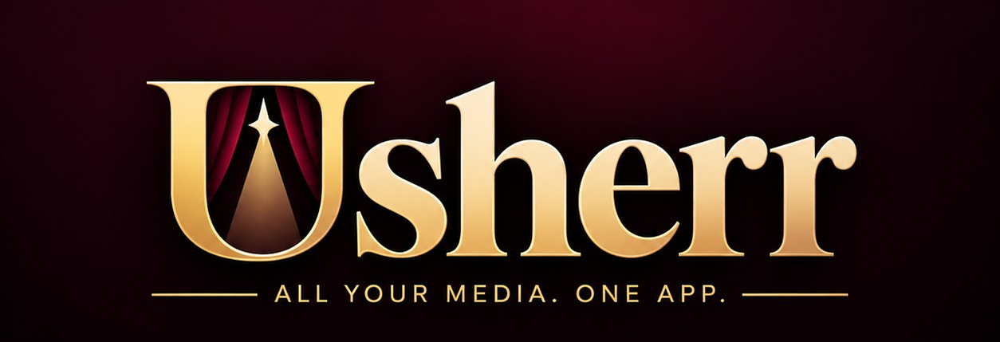

<p align="center">
  
</p>

<p align="center">
  <a href="#install">Install</a> ·
  <a href="#whats-different-from-mediarium">What's different</a> ·
  <a href="docs/README.md">Documentation</a> ·
  <a href="https://github.com/TryToTilt/Usherr/issues">Report a problem</a>
</p>

# Usherr

Usherr is a self-hosted home media app: it finds, downloads, streams and organises your movies, shows, music, books and comics, and then helps everyone in the house pick something to watch.

It is built on **[Mediarium](https://github.com/rdborg/Mediarium) by rdborg**, and keeps everything Mediarium does: one app instead of Radarr, Sonarr, Prowlarr, SABnzbd, a torrent client and Bazarr, with built-in Usenet and torrent downloading, a VPN for torrents, quality profiles, subtitles, family accounts and requests. On top of that, Usherr adds the side of the app that's about *watching*: taste, recommendations, a diary, streaming and more.

> Usherr is an independent fork. It isn't made, checked or supported by rdborg. Please report problems with Usherr [here](https://github.com/TryToTilt/Usherr/issues), not to Mediarium.

## What's different from Mediarium

**Finding something to watch**
- **For you**: a taste profile for each person, from thumbs up and down and what they watch in Jellyfin or Emby, with "For you" rows, a match percentage on every title and the reason ("because you liked Arrival").
- **Rate 20**: thumb through twenty titles to teach it your taste in a minute.
- **Tonight**, **Pick for the Room** and **Roulette**: one tap for what to watch, for you or everyone on the sofa, leaning towards what fits the people watching.
- **Discover recipes**: saved filters that become their own rows, ready-made rows, the services you subscribe to, a family filter by age, and following actors and directors.
- **Ask**: a search bar that understands "a 90s heist movie, not too violent" (with your own AI: Ollama, Claude or another).

**Your own page**
- **You**: your taste in films and shows, everything you've voted on, and, if you choose to share it, how much taste you have in common with others in the house.
- **Diary**: what you watched and when, filled in from Jellyfin by itself, with stars and notes; import from Letterboxd or a public Trakt profile.
- **Wrapped**: your year in watching.

**Watching**
- **Your stack**: the films and shows you want to watch next, as a stack of tickets in the menu to swipe through, reorder and play straight from.
- **Streaming**: play from Usenet without downloading first, with Usherr's own engine or StreamNZB, and a streamed library that sits next to your files in Jellyfin, and in Plex through Usherr's own virtual drive (streams you add reach Plex within minutes). **Streams for you** can add films that fit someone's taste, a few a week, with nothing downloaded.
- **Live TV**: channels built from your library and streams, programmed like a network, with Real TV (a real network's day, as it aired), guide looks of their own, and the channels in Jellyfin, Plex and IPTV apps.
- **The Marquee**: a lobby display for a tablet or a screen by the TV in seven looks, with what's playing, trailers, tonight on Live TV, your own slides and a cinema pre-show, steered from your phone, Home Assistant or the API.
- **The pre-show**: before a film, a cinema's welcome, trailers for what's coming (downloaded ahead, up to 4K), your own clips by category, holiday clips in their season, the rating and the countdown. Themes and schedules pick what plays; it runs on the Showtime screen, in Usherr's player and in every Jellyfin app.
- **Re-Posterr**: the best poster, background and logo for every title in Jellyfin, from TMDB and fanart.tv, approved by you first (or filled in by itself), chosen by hand on any title, and every change can be put back. Or made in your own style: the title in a font and layout of your choosing on art without words, with season posters and episode title cards.
- **Pick up where you left off**: films, episodes, streams, games and comics open where you stopped, on any device. **Skip intro** jumps past an intro, and *Up next* comes up at the credits.
- **Read-to-Me**: turn an ebook into an audiobook with a computer voice (Kokoro or Chatterbox, on your graphics card), a full cast for the dialogue if you like.
- **Sports**: leagues, teams and games, streamed, with live scores and a scoreboard on the Marquee.
- **Comics**: follow series and story arcs from ComicVine, find issues on your indexers and read them in a page-turning reader.

**And more**: what's in theaters near you with showtimes and your ticket service, a news feed, critic scores, "complete your library", schedules and quiet hours for heavy work, a guided setup with an in-app manual, a cinema look of its own and a soft one (Usherr Neu) with a choice of main colours.

## Install

**New to this? [Start here](https://trytotilt.github.io/Usherr/start/)**: six steps, on Windows, from nothing to Usherr and Jellyfin running, with what you'll see and how to fix it at each one. Nothing to download from that page except your own setup file. Already running? **[Show me how](https://trytotilt.github.io/Usherr/guide/)** has every feature, step by step.

Usherr runs as one Docker container. Copy [docker/docker-compose.yml](docker/docker-compose.yml), change the lines marked `CHANGE`, and start it. In short:

```yaml
services:
  usherr:
    image: ghcr.io/trytotilt/usherr:latest
    container_name: usherr
    restart: unless-stopped
    ports:
      - "8264:8264"
    environment:
      - PUID=1000
      - PGID=1000
      - TZ=America/Chicago
    volumes:
      - ./config:/config
      - /path/to/your/media:/data
```

Then open `http://<your-server-ip>:8264` and follow the setup. The full guide is [docs/INSTALL.md](docs/INSTALL.md): Usherr installs exactly like Mediarium, so wherever the documentation says Mediarium, read Usherr.

**Keys.** Usherr doesn't come with built-in keys for TMDB (film and show details), OpenSubtitles or Trakt. TMDB's is needed and free: make one at [themoviedb.org](https://www.themoviedb.org/settings/api) and paste it during setup. The others are optional.

**Updates.** *Settings → System → Update now* installs new Usherr releases, checked against Usherr's own signing key.

**Coming from Mediarium?** Point Usherr at your existing config folder and it carries on with your library, settings and accounts. It adds its own tables, so going back to Mediarium afterwards isn't supported: keep a backup of the config folder first.

### NSFW 18+

Usherr includes a module for adult content (videos from StashDB, followed by performer or studio). It is **locked** unless whoever runs the server unlocks it, by adding this to the container's environment and restarting:

```yaml
      - USHERR_ALLOW_ADULT=1
```

Even then it stays off until an administrator turns it on under *Settings → Extras*, after an adults-only warning and typing a confirmation. Only administrators ever see it: it's hidden from everyone else, keeps its own library and never sends notifications. This repository contains no adult content.

## Privacy

There are no ads and no tracking. Usherr sends nothing about you or your library anywhere: Mediarium's anonymous usage numbers and private problem reports are switched off. Problem reports open as an issue on this repository, after you check the text.

## Documentation

- The **in-app guide** (the **?** in the top bar) covers everything, Usherr's own features included.
- [docs/](docs/README.md): Mediarium's documentation, which applies to Usherr.
- [docs/home/](docs/home/getting-started.md): the guide to Usherr's own features.

## Credits and licence

Usherr is built on [Mediarium](https://github.com/rdborg/Mediarium) by rdborg and is, like it, free software under the [GNU Affero General Public License v3.0](LICENSE). If you run a changed copy for other people, the licence asks you to offer them its source. Other open-source work it uses or learned from is listed in [THIRD_PARTY_NOTICES.md](THIRD_PARTY_NOTICES.md) and [docs/home/CREDITS.md](docs/home/CREDITS.md).

Usherr is a tool for managing media you have the right to use. It doesn't host, index or supply any content.
