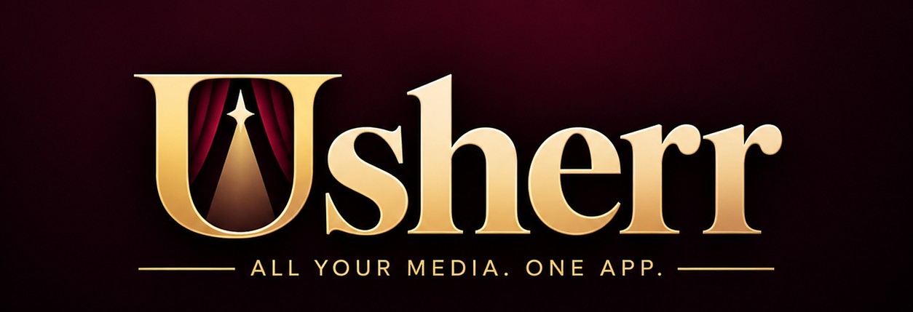

<p align="center">
  
</p>

<p align="center">
  <a href="#install">Install</a> ·
  <a href="#whats-different-from-mediarium">What's different</a> ·
  <a href="docs/README.md">Documentation</a> ·
  <a href="https://github.com/TryToTilt/Usherr/issues">Report a problem</a>
</p>

# Usherr

Usherr is a self-hosted home media app: it finds, downloads, streams and organises your movies, shows, sports, music, books, comics and manga, then helps everyone in the house pick something to watch, and lets you watch it together with friends in their own homes.

It is built on **[Mediarium](https://github.com/rdborg/Mediarium) by rdborg**, and keeps everything Mediarium does: one app instead of Radarr, Sonarr, Prowlarr, SABnzbd, a torrent client and Bazarr, with built-in Usenet and torrent downloading, a VPN for torrents, quality profiles, subtitles, family accounts and requests. On top of that, Usherr adds the side of the app that's about *watching*: taste, recommendations, a diary, streaming and more.

**Made for the sofa.** Usherr's look, **Broadcast**, is dark and clear and works with a TV remote as well as a mouse: open it in the browser of an NVIDIA Shield, a Google TV or a Fire TV, and the arrows, OK, Back, Options and the play keys do what you'd expect, on every page, the player, Live TV's guide and the readers included. The TV signs in with your phone (scan a code, press Approve), and anything with typing to do can be finished on your phone. One menu with seven places (Home, Find, Library, Live TV, Movie night, You and Server) works the same on a computer, a TV and a phone. The older looks, **Usherr Neu** and **Usherr Classic**, are still there, unchanged, for anyone who prefers them. See [Broadcast and the remote](docs/home/broadcast.md).

> Usherr is an independent fork. It isn't made, checked or supported by rdborg. Please report problems with Usherr [here](https://github.com/TryToTilt/Usherr/issues), not to Mediarium.

## What's different from Mediarium

**On the TV**
- **Broadcast**, the default look: made from the sofa out, with one blue that shows where you are, its own font and numbers that line up. A light version is there for the light setting.
- **A TV remote everywhere**: the arrows move to the nearest thing, OK opens it, Back goes back, the Options key opens **More** for what has the focus, Play/Pause, fast forward and rewind work in the player, music and the readers, and sliders only move once you grab them.
- **Sign in on a TV with your phone**: a code and a QR code on the TV, Approve on your phone. Codes work once, for five minutes. **Finish on your phone** opens the page you're on, on your phone, to type there.
- **One menu**: Home, Find, Library, Live TV, Movie night, You and, for administrators, Server with Today, Activity and the settings in seven groups. Icons, always open or hidden; a bar along the bottom on a phone.
- **Screens for the remote**: a Home with Resume and Tonight, title pages with one main button and a More sheet, the player's own controls, a Live TV guide with a line at now, a full-screen lobby for movie night, and a channel editor with almost no typing.

**Finding something to watch**
- **For you**: a taste profile for each person, from thumbs up and down and what they watch in Jellyfin, Plex or Emby, with "For you" rows, a match percentage on every title and the reason ("because you liked Arrival").
- **Rate 20**: thumb through twenty titles to teach it your taste in a minute.
- **Tonight**, **Pick for the Room** and **Roulette**: one tap for what to watch, for you or everyone on the sofa, leaning towards what fits the people watching.
- **Discover recipes**: saved filters that become their own rows, ready-made rows, the services you subscribe to, a family filter by age, and following actors and directors.
- **Ask**: a search bar that understands "a 90s heist movie, not too violent" (with your own AI: Ollama, Claude or another).

**Your own page**
- **You**: your taste in films and shows, everything you've voted on, and, if you choose to share it, how much taste you have in common with others in the house.
- **Diary**: what you watched and when, filled in from Jellyfin or Plex by itself, with stars and notes; import from Letterboxd or a public Trakt profile.
- **Wrapped**: your year in watching.

**Watching**
- **Your stack**: the films and shows you want to watch next, as a stack of tickets in the menu to swipe through, reorder and play straight from.
- **Streaming**: play from Usenet without downloading first, with Usherr's own engine or StreamNZB, and a streamed library that sits next to your files in Jellyfin, and in Plex through Usherr's own virtual drive (streams you add reach Plex within minutes). **Streams for you** can add films that fit someone's taste, a few a week, with nothing downloaded.
- **Live TV**: channels built from your library and streams, programmed like a network, with Real TV (a real network's day, as it aired), guide looks of their own, and the channels in Jellyfin, Plex and IPTV apps.
- **The Marquee**: a lobby display for a tablet or a screen by the TV in seven looks, with what's playing, trailers, tonight on Live TV, your own slides and a cinema pre-show, steered from your phone, Home Assistant or the API.
- **The pre-show**: before a film, a cinema's welcome, trailers for what's coming (downloaded ahead, up to 4K), your own clips by category, holiday clips in their season, the rating and the countdown. Themes and schedules pick what plays; it runs on the Showtime screen, in Usherr's player and in every Jellyfin app.
- **Re-Posterr**: the best poster, background and logo for every title in Jellyfin, from TMDB and fanart.tv, approved by you first (or filled in by itself), chosen by hand on any title, and every change can be put back. Or made in your own style: the title in a font and layout of your choosing on art without words, with season posters and episode title cards.
- **Pick up where you left off**: films, episodes, streams, games and comics open where you stopped, on any device. **Skip intro** jumps past an intro, and *Up next* comes up at the credits.
- **Read-to-Me**: turn an ebook into an audiobook with a computer voice (Kokoro or Chatterbox, on your graphics card), a full cast for the dialogue if you like.
- **Sports**: leagues, teams and games, streamed or downloaded by Usherr's own engine (no Sportarr needed), with live scores and a scoreboard on the Marquee.

**Watching together**
- **Linked Usherrs**: link with friends who run their own Usherr, through an end-to-end encrypted relay. Nothing is opened to the internet and no video crosses between houses.
- **Linked screenings**: invite them to a Showtime; everyone's film plays in step, pre-show included, with the host's play and pause going to every house.
- **The party**: a lobby with a seat map, a chat that reaches every house, reactions pinned to the moment of the film, a phone companion with a remote for the host, an intermission, and a verdict at the credits that goes to your Diary.
- **Ticket stubs and badges**: a collectible stub for every party, stamped SEEN when you stay to the end, and a badge cabinet.
- **Crews**: your movie-night group between parties, with a chat, a shared watchlist, a vote on the next film, film clubs that book themselves, and Crew Wrapped at the end of the year. Discord watch parties work too, with your own bot.

**Reading and listening**
- **Manga**: add a series by its English title; volumes come from your indexers, official English editions first, with fan scans and Nyaa only if you choose them. Chapters from MangaDex and your own MangaDex account are optional. Discover, a reader with page curl and panel-by-panel reading, and files from other apps brought in as they are.
- **Comics**: follow series and story arcs from ComicVine, find issues on your indexers and read them page by page, panel by panel or as a webtoon.
- **Books**: a page that curls like paper, bookmarks and highlights, sending a book to your Kindle or e-reader by email, and your place kept with KOReader and Readest.
- **Music**: phone apps (Symfonium, DSub, Feishin and other Subsonic apps), Last.fm, playlists from your .m3u files, and a Picard-style **Tidy up** that renames and tags albums with Undo.

**Running it**
- **Watching**: its own watch history and stats from Plex, Jellyfin and Emby. **Service checks**: a message when Jellyfin or a download client stops answering. **Clean-up rule sets** with a Leaving soon list everyone can see, and streamed titles never touched.
- **Collections and poster badges** in Jellyfin and Plex, kept up to date, with every original poster kept.
- **Simple or Advanced** quality profiles, tags that decide where a title searches, and friends signing in with their Jellyfin or Plex account.

**And more**: what's in theaters near you with showtimes and your ticket service, a news feed, critic scores, "complete your library", schedules and quiet hours for heavy work, a guided setup with an in-app manual, and besides Broadcast, two more looks: Usherr Classic, a cinema look of its own, and a soft one (Usherr Neu) with a choice of main colours, also as **Neu, new layout**, with a Home page for watching and a Server area for admins.

## Install

**New to this? [Start here](https://trytotilt.github.io/Usherr/start/)**: six steps, on Windows, from nothing to Usherr and Jellyfin running, with what you'll see and how to fix it at each one. Nothing to download from that page except your own setup file. Already running? **[Show me how](https://trytotilt.github.io/Usherr/guide/)** has every feature, step by step.

Usherr runs as one Docker container. Copy [docker/docker-compose.yml](docker/docker-compose.yml), change the lines marked `CHANGE`, and start it. In short:

```yaml
services:
  usherr:
    image: ghcr.io/trytotilt/usherr:latest
    container_name: usherr
    restart: unless-stopped
    ports:
      - "8264:8264"
    environment:
      - PUID=1000
      - PGID=1000
      - TZ=America/Chicago
    volumes:
      - ./config:/config
      - /path/to/your/media:/data
```

Then open `http://<your-server-ip>:8264` and follow the setup. `latest` is the newest release (2.61.2 at the time of writing); pin a version such as `ghcr.io/trytotilt/usherr:2.61.2` if you'd rather update by hand. The image is built on Debian with Jellyfin's ffmpeg, so Live TV can encode on an NVIDIA, Intel or VAAPI graphics card: see [A graphics card](docs/INSTALL.md#a-graphics-card-optional-usherr). The full guide is [docs/INSTALL.md](docs/INSTALL.md): Usherr installs exactly like Mediarium, so wherever the documentation says Mediarium, read Usherr.

**Keys.** Usherr doesn't come with built-in keys for TMDB (film and show details), OpenSubtitles or Trakt. TMDB's is needed and free: make one at [themoviedb.org](https://www.themoviedb.org/settings/api) and paste it during setup. The others are optional.

**Updates.** *Settings → System → Update now* installs new Usherr releases, checked against Usherr's own signing key.

**Coming from Mediarium?** Point Usherr at your existing config folder and it carries on with your library, settings and accounts. It adds its own tables, so going back to Mediarium afterwards isn't supported: keep a backup of the config folder first.

### NSFW 18+

Usherr includes a module for adult content (videos from StashDB, followed by performer or studio). It is **locked** unless whoever runs the server unlocks it, by adding this to the container's environment and restarting:

```yaml
      - USHERR_ALLOW_ADULT=1
```

Even then it stays off until an administrator turns it on under *Settings → Extras*, after an adults-only warning and typing a confirmation. Only administrators, and accounts an administrator gives the NSFW 18+ permission, ever see it: it's hidden from everyone else, is reached only from its own page (never from Discover's or the Library's media picker), keeps its own library, never sends notifications and is never shared with crews. This repository contains no adult content.

## Privacy

There are no ads and no tracking. Usherr sends nothing about you or your library anywhere: Mediarium's anonymous usage numbers and private problem reports are switched off. What you choose to connect is the exception, and only what it needs: a linked friend's Usherr sees a screening or crew you share with it (through a relay that can't read it), and Last.fm, ListenBrainz or MangaDex get what you play or read once you connect your own account. Problem reports open as an issue on this repository, after you check the text.

## Documentation

- The **in-app guide** (the **?** in the top bar, or **You › User guide** in Broadcast) covers everything, Usherr's own features included.
- [docs/home/broadcast.md](docs/home/broadcast.md): the Broadcast look, the one menu, the TV remote's keys, signing in on a TV, and where every page moved.
- [docs/](docs/README.md): Mediarium's documentation, which applies to Usherr.
- [docs/home/](docs/home/getting-started.md): the guide to Usherr's own features, including [watching together](docs/home/watch-together.md) and [running the server](docs/home/server.md).
- [docs/manga.md](docs/manga.md): Manga, MangaDex included. [docs/home/link-protocol.md](docs/home/link-protocol.md): how linked Usherrs talk, for anyone running their own relay.
- [docs/FEATURES.md](docs/FEATURES.md#26-what-usherr-adds-as-of-usherr-2612): what Usherr adds, in one table.

## Credits and licence

Usherr is built on [Mediarium](https://github.com/rdborg/Mediarium) by rdborg and is, like it, free software under the [GNU Affero General Public License v3.0](LICENSE). If you run a changed copy for other people, the licence asks you to offer them its source. Other open-source work it uses or learned from is listed in [THIRD_PARTY_NOTICES.md](THIRD_PARTY_NOTICES.md) and [docs/home/CREDITS.md](docs/home/CREDITS.md).

Usherr is a tool for managing media you have the right to use. It doesn't host, index or supply any content.
