# Finding something to watch

Everything here works the same in a browser, on a phone or on a tablet. You
don't need to know how anything is set up: find something, then **Add** it,
**Play** it or **Stream** it.

The first time you sign in, a short tour points out the main places: the AI
bar, Discover, the Library, Upcoming and this guide. **Skip the tour** ends it;
**Take the tour** at the top of the user guide plays it again.

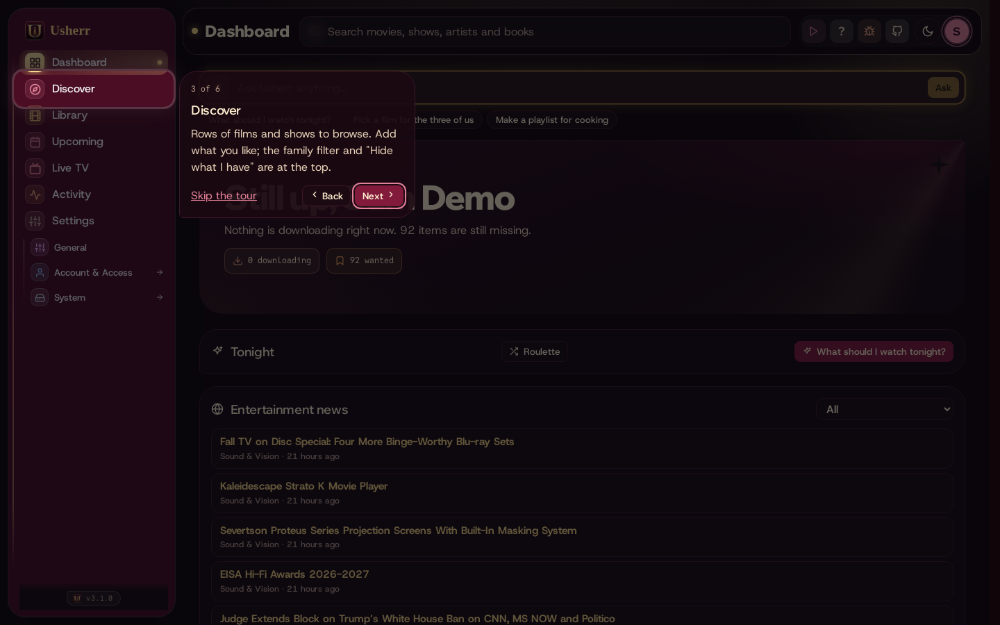

## The Dashboard

The first page you see.

- **Ask Mediarium anything** at the top: type what you're in the mood for, in
  your own words, such as *a 90s heist movie, not too violent*. The chips under
  it are ideas to tap.
- **Tonight**: tap **What should I watch tonight?** for three picks from what's
  already here: things you're part-way through, the next episode of shows you
  watch, and films and shows you have but haven't seen.
- **Entertainment news**: short summaries of film, TV, music, book and comic
  news, with a link to each full story. A title a story mentions links to your
  library, or can be added. On the Dashboard it is one line at the top: a
  headline that changes every few seconds, or a ticker, or off (each person
  picks, in **All news** or Settings › General).

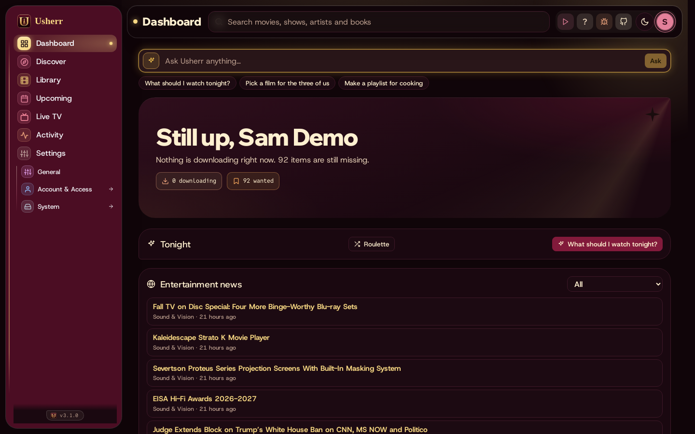

## Roulette

Can't decide? **Roulette** (on the Tonight card and on Discover, next to
*Your recipes*) spins for one title:

- **Already here** picks from what the people watching can play and haven't
  seen; **Something new** picks from well-rated titles the house doesn't have yet.
- Choose a film or a show, who's watching, a mood and, for films, how long it
  may be. The family filter counts too.
- The better rated come up more often, but anything can. **Spin again** for
  another.

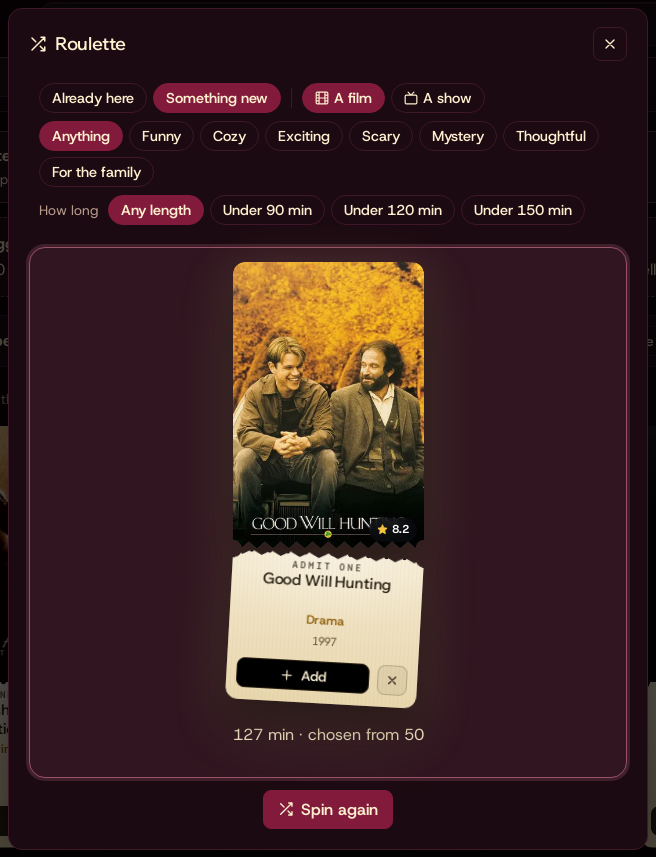

## Thumbs up and down

Tell Mediarium what you like, and what isn't for you. Your votes are your own:
nobody else in the household sees them.

- **Like** and 👎 are on every title's page: films, shows, artists, albums,
  books and comics. On Discover, the thumbs are on each poster; in the Library,
  under each card. Tap a lit thumb again to take the vote back.
- A title you've given 👎 no longer shows up in Discover's rows.
- **Rate 20** (on Discover, next to *Roulette*) is the quick way to start: 20
  titles one at a time, some from your library and some well-known ones. Say if
  you liked it, or if it looks like your kind of thing, or skip. The arrow keys
  work too: → likes, ← passes on it, space skips.

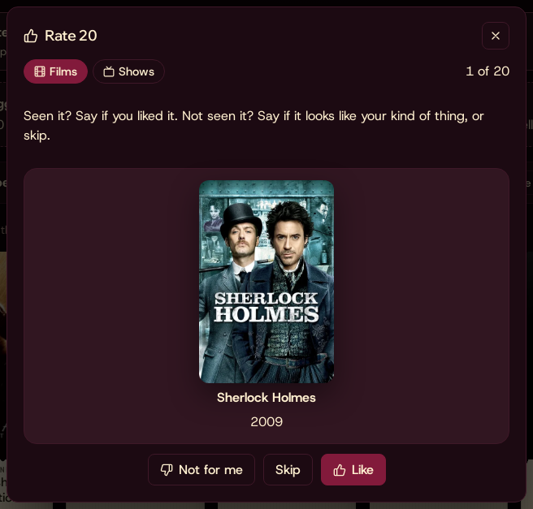

## Your stack

The films and shows you've pulled out to watch next, kept as a stack of
tickets in the menu, under **Settings**. It is your own, and it follows you to
your phone.

- **Stack** puts a title on top: the stack button on any poster card
  (Discover, the Library) and on a title's page. Tap it again to take it off.
  The stack holds up to 50.
- Swipe the front ticket left or right to go through the stack, or use the
  arrows under it (← and → work too, once the stack has focus).
- Tap the poster for **Its page** or **Play now**. A film that isn't
  downloaded offers **Stream** instead; a show opens its page so you can pick
  the episode.
- The buttons under the ticket move it up or down the stack, take it off, or
  play it.
- **Settings** folds away in the menu to make room; tap it to open its pages,
  and the stack moves down.

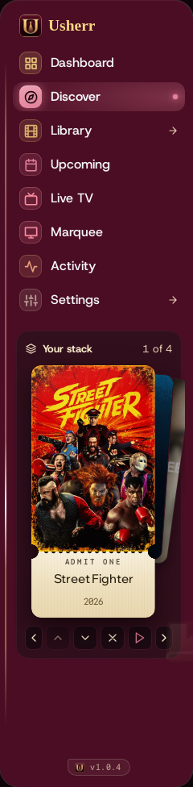

## For you

From your votes and what you watch in Jellyfin, Mediarium works out your taste
for films and for shows: the genres, subjects, actors, directors and creators
you keep coming back to, and the ones you don't. Nobody else sees it.

- **For you** is the first row on Discover once there's enough to go on (a few
  thumbs up, or a few films watched). Each title shows its **match** and why:
  *87% match · because you liked Arrival*. Until then, the row invites you to
  **Rate 20**.
- A title's page shows your match next to the thumbs (hover over it for why).
  Once you've voted on a title, your vote says more, and the match goes away.
- In the **Library**, the *Smart* shelves start with a **For you** shelf: what
  you have but haven't watched, best fit first. **Sort → For you** orders the
  whole Library that way; what you've already watched comes after, and a
  thumbs down last.
- **Tonight**, **Pick for the Room** and **Roulette** lean towards what fits
  the people watching, and never pick what any of them gave a thumbs down.

A match of 50% is an ordinary title for you; the 80s and 90s are the ones most
like your favourites. It changes as you vote and watch.

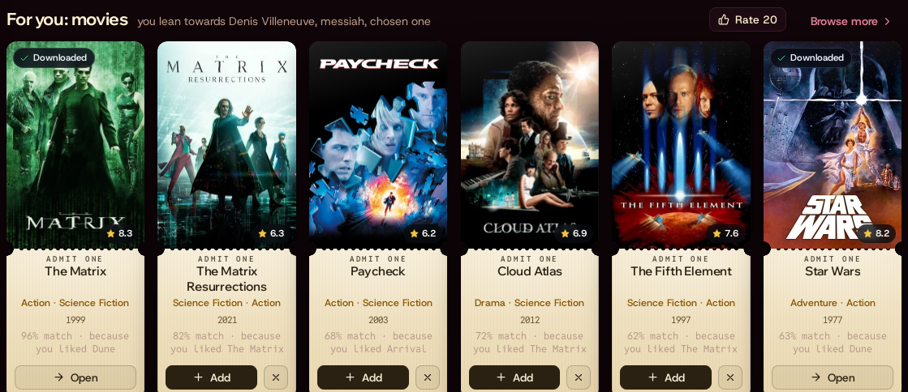

## You

**You** (in the menu behind your initial, top right) is your own page:

- **Your taste** in films and in shows: the people, subjects and genres you
  lean towards, and the ones you don't, worked out from your votes and what
  you watch. It changes as you go.
- **For you**, for films and for shows.
- **Your votes**, on everything: films, shows, artists, albums, books and
  comics. Choose a kind, or only what you liked or didn't; tap a thumb to take
  a vote back, or a title to open it.
- Who you **follow**, your **recipes** and your **services**, a tap away.
- **The household:** switch on *Share my taste with the household* to see how
  much taste you have in common with the others who share theirs, and what you
  both like. Only people who share their own see yours, and nobody sees your
  votes.

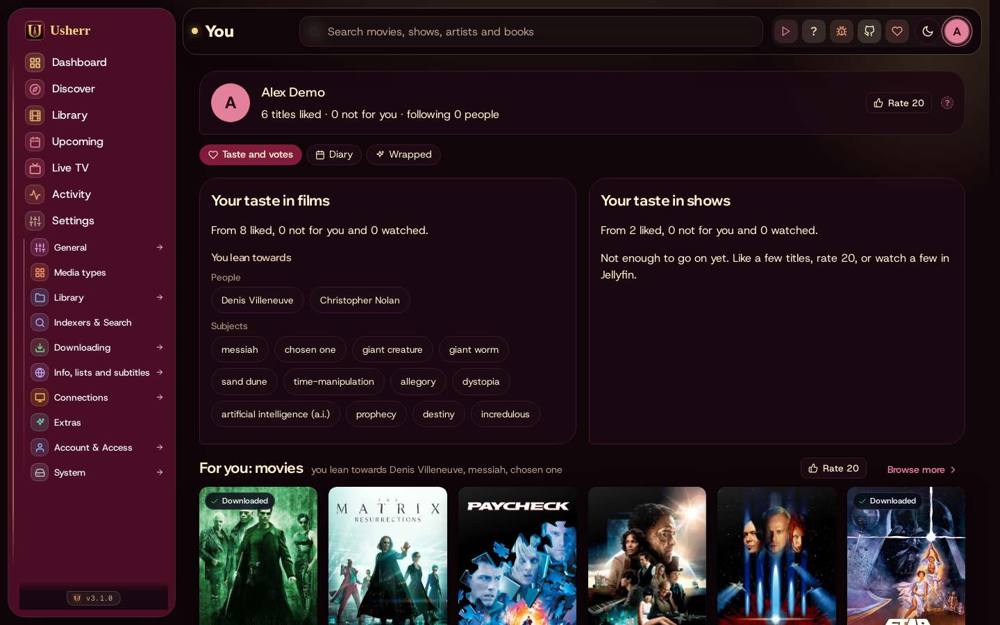

### Streams for you

On the **You** page, **Streams for you** puts the films that fit your taste best
into the streamed library by themselves, so there's always something new for
you there.

- An administrator first switches on **Allow Streams for you in this
  household**; then each person decides for themselves with **Add films that
  fit my taste**. It is off for everyone until then.
- At most **three films a week** for each person, one at a time, and only very
  strong matches (85% or more). Never something you've seen or voted on, that
  the household set aside, or that the household already has anywhere: on
  disk, in the streamed library, or in the stream libraries Jellyfin reads.
- **Nothing is downloaded.** A film is added the way **Add as stream** adds one:
  StreamNZB finds a release only when someone presses play, so no indexer is
  asked when it's added.
- **Nothing is ever removed by itself.** The card lists what was added for you,
  with its match and why; **Remove** takes one back out.
- Switching it on looks for a first film straight away; after that it looks a
  few times a day. *Quiet for a while* holds it, like the other background work.

### Diary

**You → Diary** is what you watched and when, newest first, month by month.

- **It fills itself in** from what you finish in Jellyfin (or Emby): each film,
  and each show once a day with the episodes you watched (*6 episodes ·
  S3E1–S3E6*). It reads your history the first time and keeps up after that.
- **Stars and a note:** tap a star for that many, again for a half less, a
  third time to clear. The pencil writes a note. Stars count towards your taste:
  four and up as liked, two and under against.
- **Log something** adds a film or show by hand, with the day you watched it.
- **×** takes an entry out. One from Jellyfin stays out; it isn't added again.
- **Import** brings your history in:
  - **Letterboxd:** on letterboxd.com, *Settings → Import & Export → Export your
    data*, then choose the zip it gives you (or its *diary.csv*). Your diary
    comes in with its stars, rewatches and reviews, and liked films become
    thumbs up. Films you only rated or marked watched come in without a watch
    date: they count for your taste, not for Wrapped. Each film is found on TMDB
    by its name and year; the few that can't be are listed afterwards.
  - **Trakt:** type your Trakt user name. Your profile has to be public while it
    imports (you can make it private again afterwards). Your watch history and
    ratings come in. This needs Trakt's key, which an administrator adds under
    **Settings → Info, lists and subtitles → Import lists**.

The account has to match a Jellyfin user by name (user name, first name, or
the part of the e-mail address before the @) for the Diary to fill itself in;
an administrator falls back to Jellyfin's administrator.

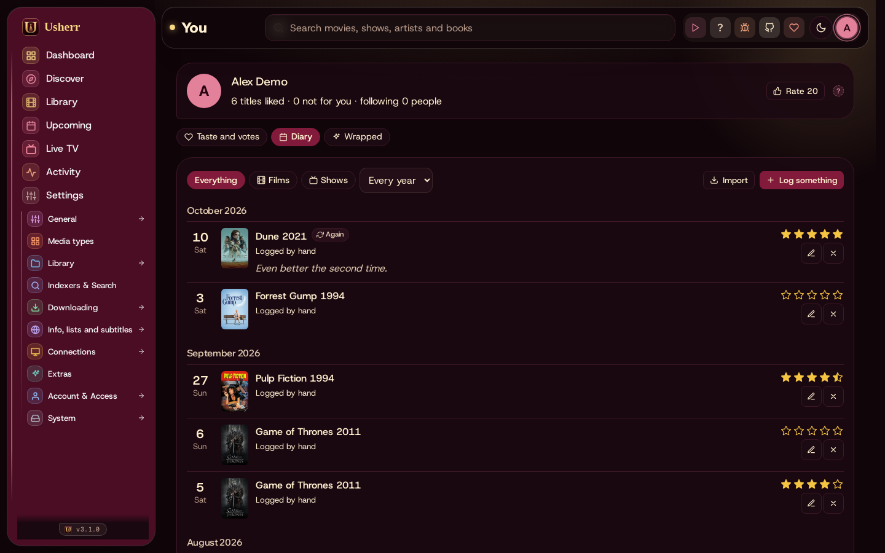

### Wrapped

**You → Wrapped** is your year in watching, from your Diary: hours, films and
episodes, films new to you and watched again, your longest run of days, your
busiest day of the week and month, the shows you couldn't stop, your best-rated
films, and what your year was made of (genres, people, subjects). Earlier years
are a tap away. When a running time isn't known, a typical film or episode is
counted, and the total says *about*.

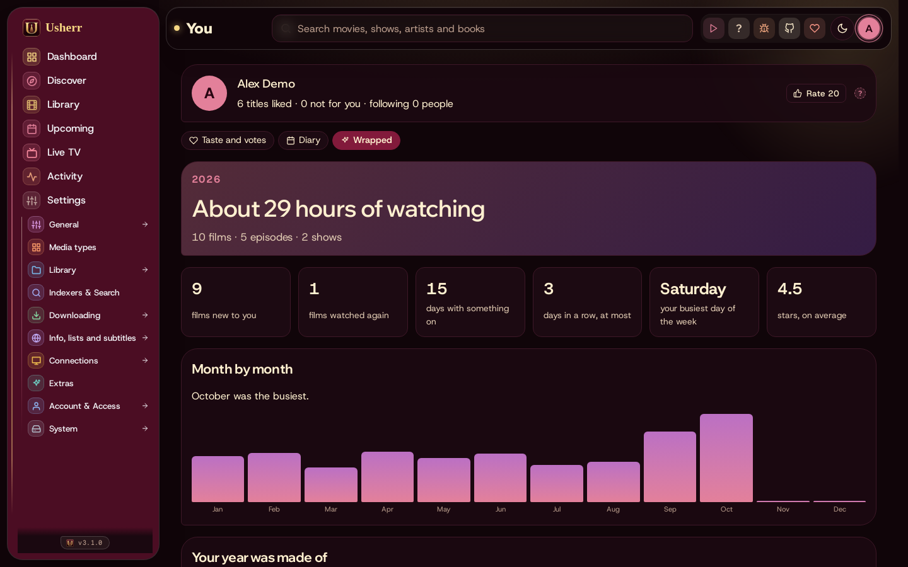

## Discover

Rows of films and shows to browse, picked in different ways. Switch between
**Movies**, **TV**, **Anime**, books, music and comics with the tabs at the top.

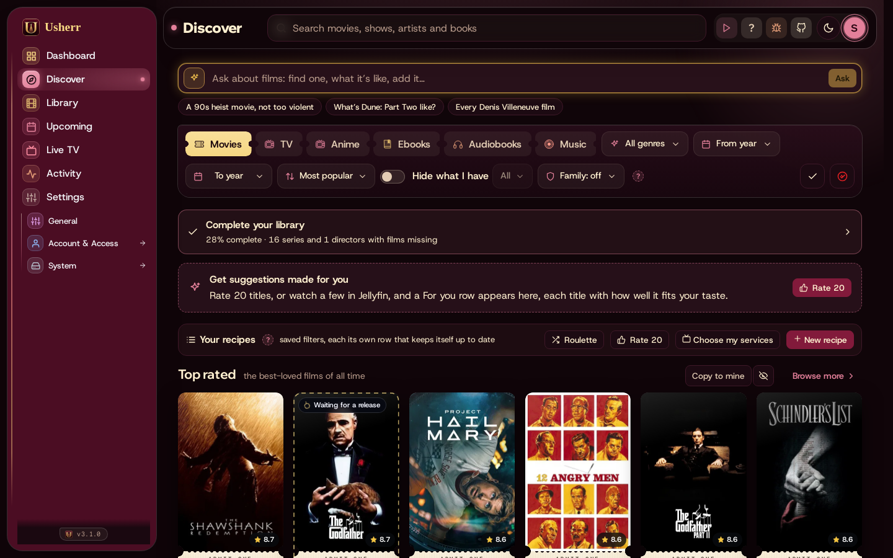

- Each card shows the poster, the year and the rating. **Add** puts it in the
  library (for something not out yet, **Add early** waits for it). **Open** is
  for something already here. The **×** on a card means *not interested*: it
  won't be suggested again.
- **Browse more** opens a whole row as pages; **Load more** adds a row in place.
- Rows you'll find, depending on what's set up:
  - **Because you watched…**, from what you've finished in Jellyfin.
  - **From people you follow**: the new and coming work of actors and
    directors you follow (see [People](#people-and-following)).
  - **Top rated**, **Box office**, **Hidden gems** and **World cinema**:
    ready-made rows. **Copy to mine** makes your own copy you can change; the
    eye button hides a row just for you.
  - **Your recipes**: your own rows, each a saved set of filters (see below).
  - The season's row (spooky films in October, holiday films in December),
    **Complete the collection** and **More like your library**.

### Ask the AI

The bar at the top of Discover takes questions about films and shows:
*find me something like this*, *what's it like?*, *every film by this
director*. You can also add a photo, such as a poster you saw. Every title the
AI names is checked, so it only suggests real ones, and nothing is added
without you.

### Your recipes

A recipe is a set of filters with a name, shown as its own row: genres, years,
a minimum rating, how long, which language, who's in it, an age rating, and
whether it's on the streaming services you pay for. **New recipe** starts one,
with ideas to start from and a preview as you go. **Choose my services** tells
Mediarium which streaming services you have, for the *On my services* rows.

### Hide what I have, and the family filter

Two switches above the rows:

- **Hide what I have** leaves out what the house already has. The menu next to
  it chooses what counts: **On disk** (downloaded), **Streamed** (played from
  the internet, nothing kept) and **Wanted** (added, not downloaded yet).
- **Family** leaves out anything that needs an older age than you choose:
  *Little kids (up to 7)*, *Kids (up to 10)* or *Teens (up to 13)*. Ages come
  from Common Sense Media where known, otherwise the US rating, otherwise an AI
  estimate. A title stays hidden until its age is known.

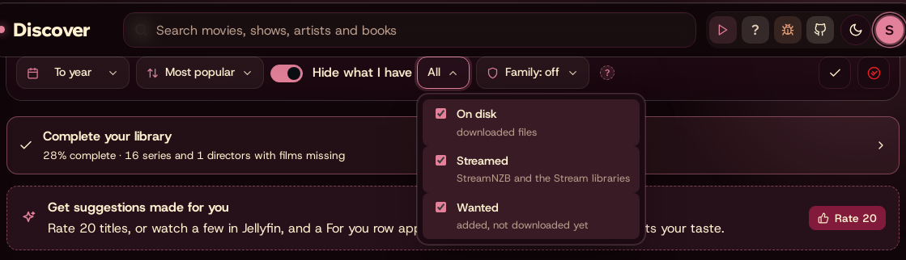

Both are remembered on each device, so the TV room and a phone can differ.

## People and following

Tap a face in a film's cast to open that person's page: who they are, and their
films and shows, best known first. **Follow** them to see what they have new or
coming in Discover's *From people you follow* row and under
**Upcoming → Following**.

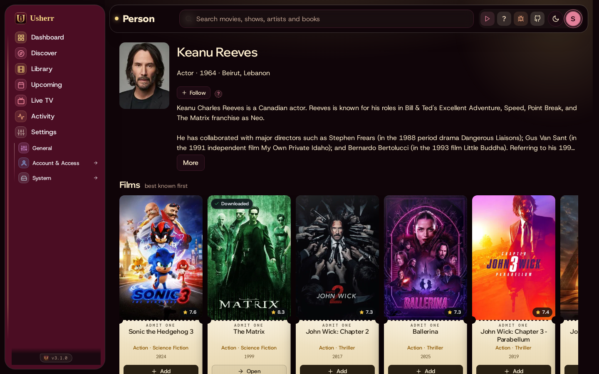

**Upcoming → Following** lists everyone you follow, what's coming soon and out
this past year, and a row for each person. Search there to follow someone by
name; the × on a name unfollows.

## Complete your library

A card on Discover (and in the Library) opens **Complete your library**: what's
missing from film series you have part of, from directors and actors you
collect, and from the classics, with how complete each is. **Ignore** hides a
series, director or actor you don't care about.

## A title's page

Tap a poster for its page: the story, cast, trailers, ratings, where it streams
(*Streaming on*), and similar titles. What you can do there:

- **Play** what's in the library, **Stream** what isn't (see
  [Watching it](watching.md)), or **Add** it.
- **What's it like?** for a short, spoiler-free description from the AI.
- On a show: **Catch me up** (a recap up to where you are) and **Skip guide**
  (which episodes matter, and which you can skip).

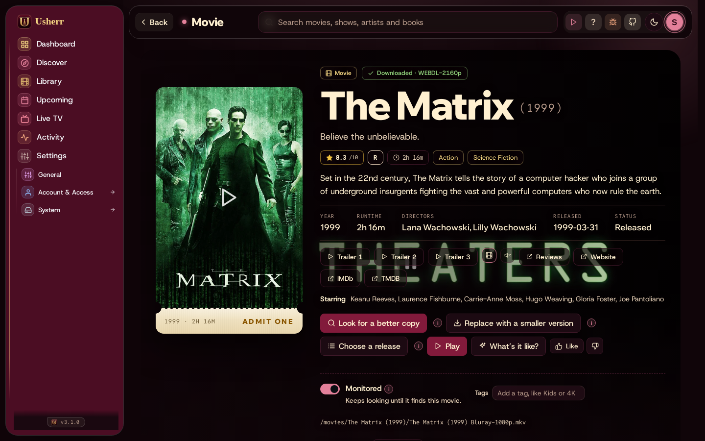
