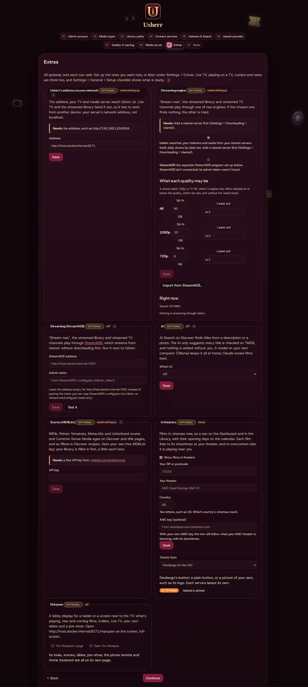
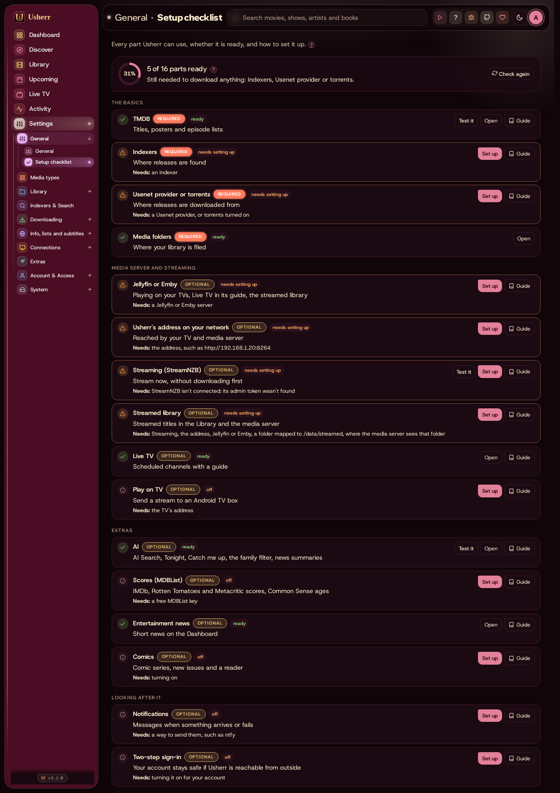
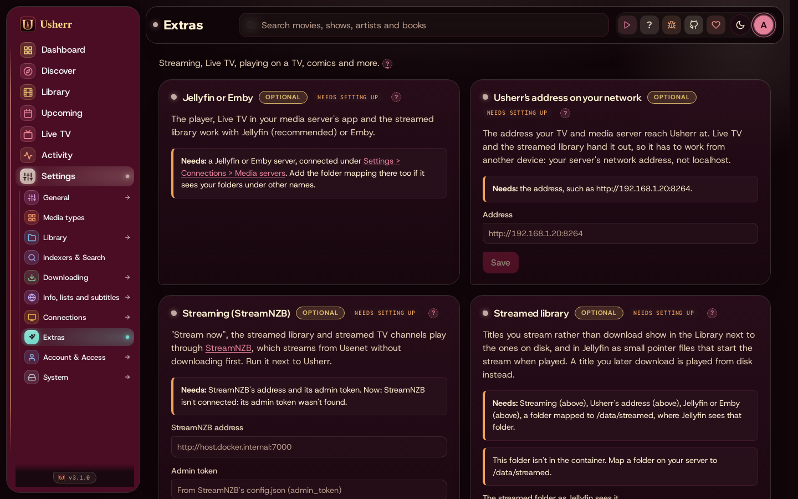

# Getting started with the home fork

This fork of Mediarium adds a lot on top of Mediarium itself: streaming
straight from Usenet, a streamed library next to the one on disk, Live TV
channels, playing on a TV box, comics, AI helpers, scores and age ratings,
Discover recipes and more. Everything Mediarium does is still here and works
the same way; this guide covers what the fork adds and how to set it up.


## What you need

**Required**

- **Docker**, on Windows (Docker Desktop), Linux or a NAS. Mediarium runs as one
  container. See *Installing* in this guide for the container itself.
- **A TMDB API key** (free). Every title, poster and episode list comes from
  TMDB. See [TMDB](integrations.md#tmdb).
- **Somewhere to download from**: a Usenet provider plus at least one indexer
  (or torrents). See [Usenet and indexers](integrations.md#usenet-and-indexers).

**Optional, each adds something**

| Add | What you get | Card |
|---|---|---|
| Jellyfin or Emby | Play in your media server's apps, Live TV in its guide, the streamed library | [Jellyfin or Emby](integrations.md#jellyfin-or-emby) |
| StreamNZB | "Stream now": play from Usenet without downloading first | [StreamNZB](integrations.md#streaming-streamnzb) |
| An AI (Ollama or Claude) | The Ask bar, Tonight, Catch me up, the family filter's estimates, news summaries, AI-built Live TV channels | [The AI](ai.md) |
| MDBList key | IMDb, Rotten Tomatoes and Metacritic scores, Common Sense Media ages | [Scores](integrations.md#scores-mdblist) |
| ComicVine key | Comics: series, new issues, story arcs | [Comics](integrations.md#comics) |
| An Android TV box | Play on TV: send a stream to the box | [Play on TV](integrations.md#play-on-tv) |
| Nothing extra | Live TV: channels from your library and streams, free live channels, Real TV, in Jellyfin, Plex and IPTV apps | [Live TV](live-tv.md) |
| A tablet or a spare screen | The Marquee: a lobby display of what's playing, coming and on Live TV, with a pre-show, steered from your phone or Home Assistant | [The Marquee](marquee.md) |
| Nothing extra (Jellyfin for its app) | The pre-show: a cinema's welcome, trailers, your clips and the countdown before a film, in Usherr and in the Jellyfin app | [The pre-show](preshow.md) |
| Jellyfin (fanart.tv, TheTVDB optional) | Re-Posterr: the best poster, background and logo for each title in Jellyfin, or made in your style (season posters, title cards, backgrounds, overlays, a style per library), asked first, every change undoable | [Re-Posterr](re-posterr.md) |
| A graphics card | Read-to-Me: an audiobook made from an ebook with a computer voice | [Read-to-Me](read-to-me.md) |
| Nothing extra (Sportarr optional) | Sports: leagues, teams, games, streams and live scores | [Sports](sports.md) |

## The quickest way to a working server

1. Start the container and open Mediarium in a browser. The **setup wizard**
   asks for an administrator account, the media types you want, your folders,
   your TMDB key, your indexers and Usenet provider, and your media server.
   Its last step, **Extras**, offers the home fork's own parts: Mediarium's
   address on your network, the streaming engine, the AI, scores, In theaters
   (your ZIP, theater and ticket service), the Marquee, the pre-show and
   Re-Posterr. All
   of them are
   optional and can wait. Everything the wizard asks can be changed later in
   **Settings**.


2. Add a movie from **Discover**. If it downloads and lands in your library
   folder, the basics work.
3. Open **Settings → General → Setup checklist**. It lists every part
   Mediarium can use, whether it's ready, and what's missing, with a
   **Test it** button where there is one, **Set up** to go to its settings and
   **Guide** for its card in this guide.



4. Add the optional parts you want, one at a time, mostly from
   **Settings → Extras**. Each card there says what it needs, shows whether it
   is ready, and has a **Test it** button.



## Usherr's look

- **Look** (*Settings → General*): **Usherr Classic**, or **Usherr Neu**, a
  soft raised look with its own icons and font, in light and dark. Kept per
  browser.
- **Main colour**, under the highlight colour: Midnight navy, Espresso,
  Forest, Plum, Oxblood, Ocean, Stone or OLED black, each light and dark, or
  the highlight's own tint. Kept per browser.
- **The menu** is a drawer behind the hamburger on every screen. On a wide
  screen it stays open while you move between pages, and goes away after 8
  seconds without the mouse over it, with a click or touch outside it, with
  the hamburger or with Escape.
- **The filter bar** of the Library, Discover, Upcoming, Wanted, Diary,
  Comics and NSFW pulls down from under the top bar; closed, a slim handle
  says what's showing.
- **Poster size**: a slider in every library.
- **Tonight's picks** is in the top bar, beside the dice.

## How the parts fit together

```
browsers, phones ──▶ Mediarium ──▶ Usenet provider and indexers
                        │   ▲
                        │   └── StreamNZB (streams from Usenet)
                        ▼
              library folders ──▶ Jellyfin or Emby ──▶ TVs
```

- **Mediarium** finds, downloads, renames and files everything, and is where
  you browse, request and manage.
- **Jellyfin or Emby** plays it on your TVs and phones. Mediarium tells it when
  something new arrives.
- **StreamNZB** (optional) plays a title straight from Usenet. Mediarium keeps
  a list of what you stream, shows it in the Library next to what's on disk,
  and puts small pointer files in a folder Jellyfin reads, so streamed titles
  play from Jellyfin too.

## Next

- [Setting up each part](integrations.md): one card per service, with where
  to get the key, where to paste it and how to test it.
- [When something goes wrong](troubleshooting.md).
