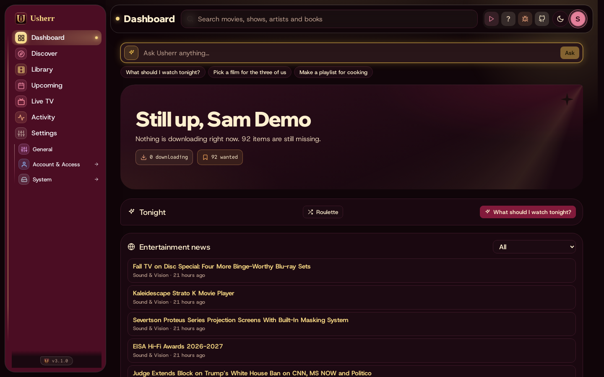
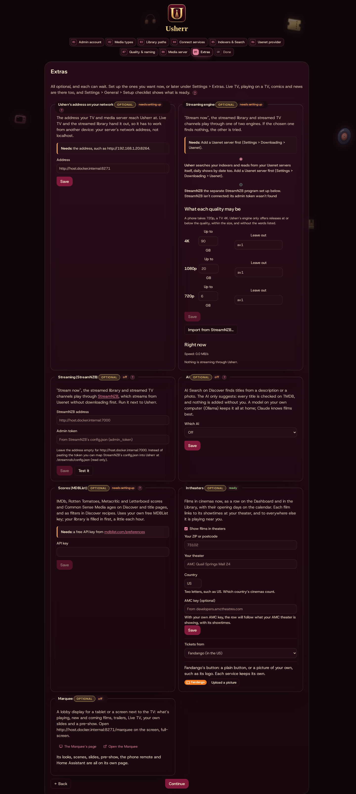
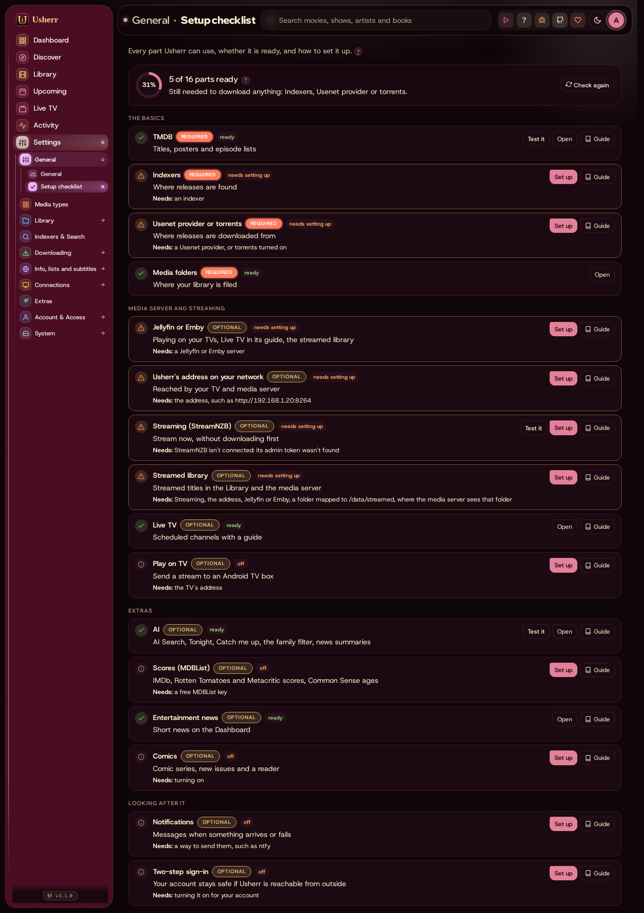
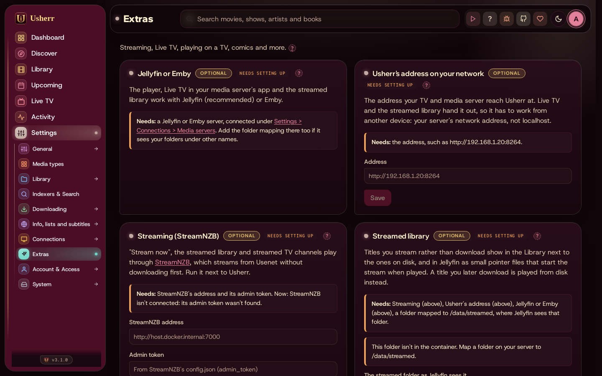

# Getting started with Usherr

Usherr is built on Mediarium and adds a lot on top of it: streaming
straight from Usenet, a streamed library next to the one on disk, Live TV
channels, the Marquee and the pre-show, Plex as well as Jellyfin, watching
together with friends' Usherrs, sports, comics and manga, music in phone
apps, AI helpers, scores and age ratings, Discover recipes and more. Everything
Mediarium does is still here and works the same way; this guide covers what
Usherr adds and how to set it up.

New to all of this? The [Start page](https://trytotilt.github.io/Usherr/start/)
goes from nothing to Usherr and Jellyfin running on Windows in six steps, and
**Show me how** (in the top bar, and
[online](https://trytotilt.github.io/Usherr/guide/)) walks you through each
feature on the real screens.



## What you need

**Required**

- **Docker**, on Windows (Docker Desktop), Linux or a NAS. Usherr runs as one
  container. See *Installing* in this guide for the container itself.
- **A TMDB API key** (free). Every title, poster and episode list comes from
  TMDB. See [TMDB](integrations.md#tmdb).
- **Somewhere to download from**: a Usenet provider plus at least one indexer
  (or torrents). See [Usenet and indexers](integrations.md#usenet-and-indexers).

**Optional, each adds something**

| Add | What you get | Card |
|---|---|---|
| Jellyfin or Emby | Play in your media server's apps, Live TV in its guide, the streamed library | [Jellyfin or Emby](integrations.md#jellyfin-or-emby) |
| Plex (rclone and WinFsp for the drive) | The same in Plex: streamed titles through the virtual drive, Live TV (Plex Pass), the pre-show, your Diary and taste | [Virtual drive](integrations.md#virtual-drive-for-plex) |
| Nothing extra (StreamNZB optional) | "Stream now": play from Usenet without downloading first, with Usherr's own engine | [Streaming engine](integrations.md#streaming-engine-usherr-or-streamnzb) |
| An AI (Ollama or Claude) | The Ask bar, Tonight, Catch me up, the family filter's estimates, news summaries, AI-built Live TV channels | [The AI](ai.md) |
| MDBList key | IMDb, Rotten Tomatoes and Metacritic scores, Common Sense Media ages | [Scores](integrations.md#scores-mdblist) |
| ComicVine key | Comics: series, new issues, story arcs | [Comics](integrations.md#comics) |
| An Android TV box | Play on TV: send a stream to the box | [Play on TV](integrations.md#play-on-tv) |
| Nothing extra | Live TV: channels from your library and streams, free live channels, Real TV, in Jellyfin, Plex and IPTV apps | [Live TV](live-tv.md) |
| A tablet or a spare screen | The Marquee: a lobby display of what's playing, coming and on Live TV, with a pre-show, steered from your phone or Home Assistant | [The Marquee](marquee.md) |
| Nothing extra (Jellyfin for its app) | The pre-show: a cinema's welcome, trailers, your clips and the countdown before a film, in Usherr and in the Jellyfin app | [The pre-show](preshow.md) |
| Jellyfin (fanart.tv, TheTVDB optional) | Re-Posterr: the best poster, background and logo for each title in Jellyfin, or made in your style (season posters, title cards, backgrounds, overlays, a style per library), asked first, every change undoable | [Re-Posterr](re-posterr.md) |
| A graphics card | Read-to-Me: an audiobook made from an ebook with a computer voice | [Read-to-Me](read-to-me.md) |
| Nothing extra (Sportarr optional) | Sports: leagues, teams, games, streams, downloads and live scores | [Sports](sports.md) |
| A friend running Usherr | Watching together: linked screenings in step, a party chat and reactions, stubs and badges, crews | [Watching together](watch-together.md) |
| Nothing extra (AniList and MangaDex optional) | Manga: series by volume or chapter, official editions first, a reader of its own | [Manga](../manga.md) |
| A Subsonic app on your phone | Your music in Symfonium, DSub, Feishin and the like; Last.fm scrobbling | [Music in phone apps](integrations.md#music-in-phone-apps-subsonic) |
| A graphics card (optional) | Live TV encoded on NVIDIA, Intel Quick Sync or VAAPI | [Live TV](live-tv.md#the-picture-encoder-and-watermark) |

## The quickest way to a working server

1. Start the container and open Usherr in a browser. The **setup wizard**
   asks for an administrator account, the media types you want, your folders,
   your TMDB key, your indexers and Usenet provider, and your media server.
   Each step has a **Show me how: this step** card saying what it is and what
   to choose. Its last step, **Extras**, offers Usherr's own parts: Usherr's
   address on your network, the streaming engine, the AI, scores, In theaters
   (your ZIP, theater and ticket service), the Marquee, the pre-show and
   Re-Posterr. All
   of them are
   optional and can wait. Everything the wizard asks can be changed later in
   **Settings**.


2. Add a movie from **Discover**. If it downloads and lands in your library
   folder, the basics work.
3. Open **Settings → General → Setup checklist**. It lists every part
   Usherr can use, whether it's ready, and what's missing, with a
   **Test it** button where there is one, **Set up** to go to its settings and
   **Guide** for its card in this guide.



4. Add the optional parts you want, one at a time, mostly from
   **Settings → Extras**. Each card there says what it needs, shows whether it
   is ready, and has a **Test it** button.



## Usherr's look

- **Look** (*Settings → General*): **Usherr Classic**, **Usherr Neu**, a
  soft raised look with its own icons and font, in light and dark, or **Neu,
  new layout**: Neu with your libraries always in sight down the side, tabs
  along the bottom of a phone, a **Home** page for watching (the next
  showtime, Continue watching, Just added, Coming soon) and one **Server**
  area for administrators with what needs you, the day-to-day pages and every
  settings group. Its **TV size** makes everything bigger for the sofa, and
  turns on by itself in a TV's own browser. Kept per browser.
- **Main colour**, under the highlight colour: Midnight navy, Espresso,
  Forest, Plum, Oxblood, Ocean, Stone or OLED black, each light and dark, or
  the highlight's own tint. Kept per browser.
- **The menu** is a drawer behind the hamburger on every screen. On a wide
  screen it stays open while the mouse is over it and slides away a moment
  after the mouse leaves (**How soon the menu slides away**, in *Settings →
  General*: from right away to 10 seconds, 3 to start with), with a click or
  touch outside it, with the hamburger or with Escape.
- **The filter bar** of the Library, Discover, Upcoming, Wanted, Diary,
  Comics and NSFW pulls down from under the top bar; closed, a slim handle
  says what's showing.
- **Poster size**: a slider in every library.
- **Tonight's picks** is in the top bar, beside the dice.

## How the parts fit together

```
browsers, phones ──▶ Usherr ──▶ Usenet provider and indexers
                       │  │
                       │  └── streams from Usenet (its own engine, or StreamNZB)
                       │        ├─▶ pointer files ──▶ Jellyfin or Emby
                       │        └─▶ virtual drive ──▶ rclone ──▶ Plex
                       ▼
             library folders ──▶ Jellyfin, Emby or Plex ──▶ TVs
```

- **Usherr** finds, downloads, renames and files everything, and is where
  you browse, request and manage.
- **Jellyfin, Emby or Plex** plays it on your TVs and phones. Usherr tells it
  when something new arrives.
- **Streaming** plays a title straight from Usenet, with Usherr's own engine
  (or StreamNZB, if you run it). Usherr keeps a list of what you stream and
  shows it in the Library next to what's on disk. Jellyfin plays streamed
  titles from small pointer files in a folder it reads; Plex can't, so Usherr
  also serves them as a [virtual drive](integrations.md#virtual-drive-for-plex)
  of ordinary video files, which rclone mounts on the Plex computer.

## Next

- [Setting up each part](integrations.md): one card per service, with where
  to get the key, where to paste it and how to test it.
- [Watching together](watch-together.md): linked Usherrs, screenings in
  step, the party and crews.
- [Running the server](server.md): watch history, service checks, clean-up
  rule sets, quality profiles, tags and signing in with Jellyfin or Plex.
- [When something goes wrong](troubleshooting.md).
