# Setting up each part

Every service the home fork can use, one card each: what it does, whether you
need it, where to get it, where to put it in Mediarium, and how to check it
works. Only the first two are required.

Most optional parts live in **Settings → Extras**. Each card there shows its
state (**Ready**, **Needs setting up** or **Off**) and a **Needs:** note that
says exactly what's missing.

## TMDB

**Required.** The Movie Database is where every title, poster, cast list and
episode list comes from, and what Discover browses.

- **Get it:** make a free account at themoviedb.org, then *Settings → API* and
  ask for a developer key. The "API Key" (v3) is the one to copy.
- **Put it in:** the setup wizard asks for it, or **Settings → Info, lists and
  subtitles → Movie and show info**.
- **Check:** Discover shows posters. Without the key, Discover is empty and
  adding a title says to add the key first.

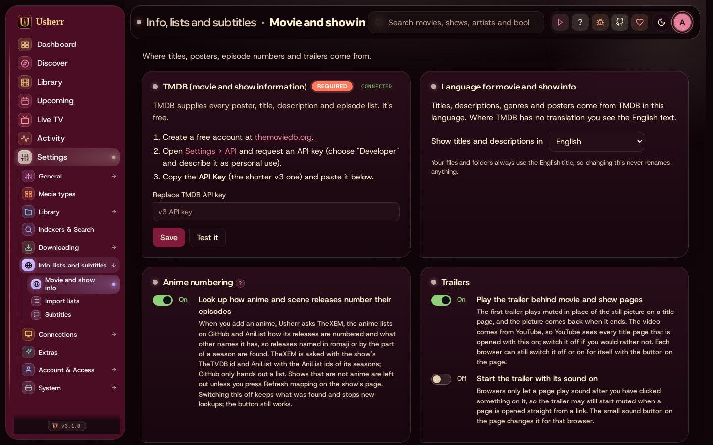

## Usenet and indexers

**Required** (or torrents instead). An indexer finds releases; a Usenet
provider is where they're downloaded from. Mediarium has its own downloader,
so no SABnzbd or NZBGet is needed.

- **Get it:** a paid Usenet provider (any with a long retention), and one or
  more Newznab indexers (most have a free tier with a daily limit). If you
  already use Prowlarr, add each indexer with its own feed address from
  Prowlarr, or bring them all over with **Settings → System → Move from other
  apps**.
- **Put it in:** **Settings → Indexers & Search** for indexers,
  **Settings → Downloading → Usenet** for the provider (address, port, SSL,
  username, password, connections).
- **Check:** each indexer and provider has a test button. Then search a title's
  releases from its page.
- **Connections:** a provider allows a set number of connections at once. If
  StreamNZB uses the same account, split them (for example 20 for Mediarium
  and 20 for StreamNZB) so streams don't starve downloads.

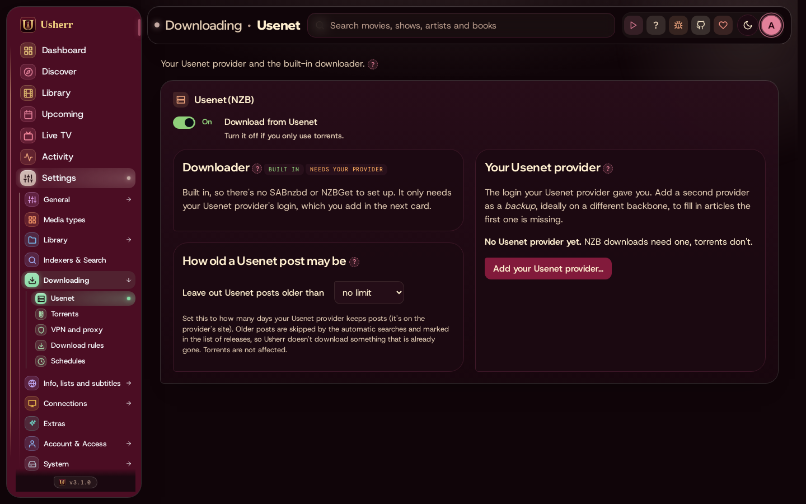

## Jellyfin or Emby

**Optional, recommended.** Plays everything on your TVs and phones, and is what
the player, Live TV and the streamed library work through.

- **Get it:** install Jellyfin (free) or Emby on the same server, with libraries
  on the same folders Mediarium files into.
- **Put it in:** **Settings → Connections → Media servers**: its address and an
  API key made in Jellyfin's *Dashboard → API Keys*. If Jellyfin sees your
  folders under other names (Jellyfin runs outside Docker, for example),
  add a **folder mapping** there too.
- **Check:** the card in **Settings → Extras** says **Ready**, and new
  downloads appear in Jellyfin within a minute.
- **While someone is watching** on the same page pauses downloads whenever
  someone is watching in Jellyfin, and resumes them about a minute after. With
  a slow line, or when streams share a Usenet account with downloads, it keeps
  playback smooth. It's off until you switch it on.

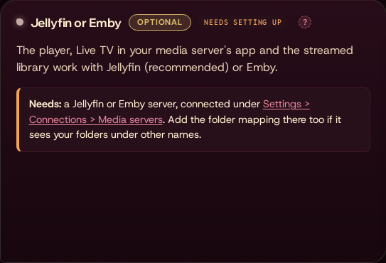

## Mediarium's address on your network

**Optional, needed for Live TV and the streamed library.** The address your TV
and Jellyfin use to reach Mediarium. It has to work from another device, so
it's your server's network address, not `localhost`.

- **Put it in:** **Settings → Extras → Mediarium's address on your network**,
  for example `http://192.168.1.20:8264`.
- **Check:** open that address on your phone while on the same network.

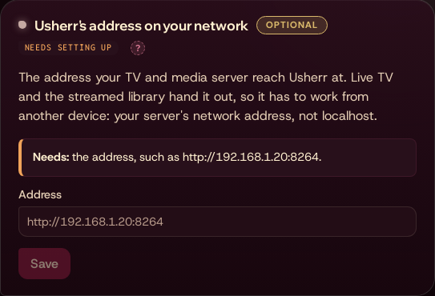

## Streaming engine (Usherr or StreamNZB)

**Settings → Extras → Streaming engine** says which engine plays streams:
**Stream now**, the streamed library (the Jellyfin pointer files) and streamed
Live TV channels. If the chosen one finds nothing, the other is tried.

- **Usherr** searches the indexers you already have, checks the release is on
  your Usenet servers and reads the video from them as you watch. No separate
  program: it needs a Usenet server and an indexer. It finds daily shows by
  their air date (General Hospital, late night), reads inside stored RAR sets,
  and keeps the other releases in line: if one stops part-way, the next plays
  from where you were (or press **Try another release**).
- **StreamNZB** is the separate program below. It is still fully supported:
  an install that already has it connected keeps using it until you choose
  otherwise, and a new install uses Usherr's engine and needs nothing else.

**Coming from StreamNZB?** **Import from StreamNZB…** on the same card copies
its Usenet providers, indexers and size limits. Choose its `config.json` (or
map it into Usherr at `/streamnzb/config.json`, read only) and you see what is
in it first: what Usherr already has is marked and left alone, and only what
you tick is copied. Logins go into Usherr's own encrypted settings and are
never shown on the page. Check the indexer addresses afterwards: they are
copied as StreamNZB uses them, and Usherr may reach them at another address.

The same card holds the **device qualities**: for 4K, 1080p and 720p, the most
a release may weigh and words to leave out (AV1 is left out because TVs can't
play it). A phone asks for 720p, the TV for 4K. Below it, **Right now** shows
the speed, how many connections are in use on each Usenet server, what is
streaming and how many searches each indexer has done today. Searches are
remembered for a few minutes, so tuning the same title again doesn't ask the
indexers again.

## Streaming (StreamNZB)

**Optional.** [StreamNZB](https://github.com/Gaisberg/streamnzb) plays a
release straight from Usenet without downloading it first. With it,
title pages get **Stream now**, and you get the streamed library and streamed
Live TV channels.

- **Get it:** run StreamNZB next to Mediarium (its own container), with your
  Usenet provider set up in it.
- **Put it in:** **Settings → Extras → Streaming (StreamNZB)**: its address
  (empty means `http://host.docker.internal:7000`) and its admin token, from
  StreamNZB's `config.json` (`admin_token`). Or map that `config.json` into
  Mediarium at `/streamnzb/config.json` (read only) and leave the token empty.
- **Check:** **Test it** on the card, then **Stream now** on any title page.

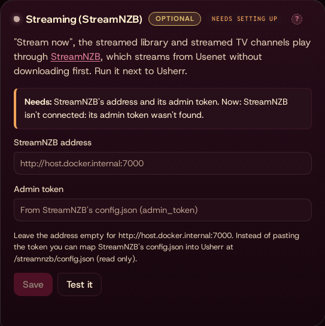

## Streamed library

**Optional, needs a streaming engine (Usherr's own is enough, see above) and Jellyfin.** Titles you
stream instead of download show in the Library next to the ones on disk, and in
Jellyfin as small pointer files that start the stream when played. A title you
later download plays from disk instead.

- **Set it up:**
  1. Map a folder on your server to `/data/streamed` in Mediarium's container.
  2. Add that folder to a Jellyfin library (or make one, such as "Streamed").
  3. In the card, enter the folder **as Jellyfin sees it**, for example
     `D:\Streamed` or `/media/streamed`. Leave it empty if the folder mapping
     under Media servers already covers it.
  4. **Put streamed titles into Jellyfin's libraries**.
- **Check:** a streamed title shows in the Library marked **Streams** (not on
  disk: plays through the streaming engine), and in Jellyfin.

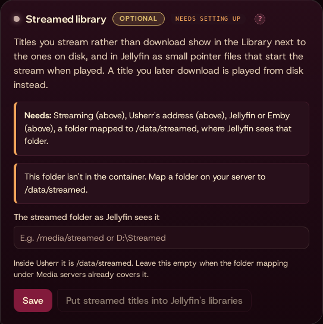

## Virtual drive (for Plex)

**Optional, for Plex.** Plex can't play the Streams library's pointer files.
The virtual drive puts the same streamed films and shows on a drive of
ordinary video files that Plex (or Jellyfin) reads like any folder; a file is
played straight from Usenet, only the part being watched. Usherr serves the
drive (WebDAV, read only); **rclone** mounts it on the computer that runs
Plex, with **WinFsp** on Windows. Both are free and come from their own
websites: Usherr doesn't install anything on your computer.

- **It's on by itself** when Plex is your media server and Jellyfin and Emby
  aren't. Otherwise switch it on in **Settings → Extras → Virtual drive (for
  Plex)**.
- **What's on the drive.** A drive needs each file's size before it's played,
  so a streamed film or episode appears once Usherr knows its release. Anything
  someone plays (in Usherr, Jellyfin or the add-on) is kept at once, at no
  cost.
- **Streams you add go on right away.** **Add as stream** puts the film, or the
  show's newest season, on the drive at once: one search a film or episode, a
  few seconds apart, and Plex has each a couple of minutes later. For a title
  already in your streams, its page has **Put it on the virtual drive now**
  (the newest season, for a show). Both use the day's searches.
- **The rest, a few a day.** Everything else is looked for one at a time
  (**Searches a day**, 30 to start with, never more than one every ten
  minutes), so your indexers' daily limits are never spent in one go: newest
  first, and a new episode of a show you stream goes to the front of the
  queue. **Get one ready now** looks for the next one straight away. A release
  that disappears from Usenet leaves the drive until another is found.
- **Its own sign-in.** The drive has its own user (`usherr`) and password,
  shown on the card. It only opens the drive, and only to read; it is never a
  person's account. **New password** makes another (then run rclone's setup
  command again).
- **Mount it** (the card has the exact commands, with your address and password
  filled in):
  1. Install [WinFsp](https://winfsp.dev/rel/) and [rclone](https://rclone.org/downloads/)
     (on Linux, rclone alone).
  2. Tell rclone about the drive, once:
     `rclone config create usherr webdav url=http://<Usherr's address>:8264/dav/ vendor=other user=usherr pass=<the drive's password> --obscure`
  3. Mount it, on Windows as drive U: (any free letter):
     `rclone mount usherr: U: --read-only --vfs-cache-mode off --dir-cache-time 1m --network-mode`
     If rclone isn't on your PATH, put the full path to `rclone.exe` in the
     card's **Where rclone is** box: the commands use it.
  4. **Optional, Windows: mount it at sign-in.** Tick the box under the
     commands to download `usherr-drive.cmd`, then move it into your Startup
     folder (Windows+R, `shell:startup`). **This installs a startup item**: it
     runs every time you sign in, waits until Usherr answers, then mounts the
     drive with its window hidden. It holds no password (rclone keeps it).
     Delete the file from that folder to stop it.
  5. In Plex, add `U:\Movies` to a Movies library and `U:\TV` (and `U:\Anime`)
     to a TV library.
- **Keep Plex light.** These are Plex settings for the whole server. In
  **Settings → Library**, set video preview thumbnails, chapter thumbnails
  and voice activity data to *never*: each would read whole films from
  Usenet. Turn on **Scan my library periodically** (Windows doesn't tell
  Plex about new files on the drive), and untick **Empty trash automatically
  after every scan**, so a moment without the drive (its window closed,
  Usherr restarting) doesn't empty its titles from Plex. In **Scheduled
  Tasks**, untick **Perform extensive media analysis during maintenance**.
  Intro and credits detection is only offered with Plex Pass.
- **Plex has new titles within minutes.** When a title comes onto the drive,
  Usherr asks each connected media server with a library on the drive to look
  at just that title's folder (never a whole library). For that it needs to
  know where the drive is mounted on the Plex computer: **Where Plex sees the
  drive** on the card, `U:` to start with (or a folder such as `/mnt/usherr`
  on Linux). A Windows letter there is also the one the commands mount.
- **Check:** the card counts the films and episodes ready, and says when
  something last read the drive. **Something not right?** in Show me how warns
  when nothing has read it for two days.

**Show me how → Set up Plex with the virtual drive** walks you through all of
this. WinFsp is Windows File System Proxy, copyright Bill Zissimopoulos
([github.com/winfsp/winfsp](https://github.com/winfsp/winfsp)); rclone is by
Nick Craig-Wood and its contributors ([rclone.org](https://rclone.org)).

## Live TV

**Optional.** Scheduled channels made from your library, from streams, from
free live channels (Pluto, PBS) or from a real network's day (Real TV), with
a programme guide. Watch them on the **Live TV** page, in Jellyfin, in Plex
or in an IPTV app.

- **Set it up:** make a channel on the **Live TV** page (**New channel**, a
  **Channel pack**, or **Build with AI**), then **Add to Jellyfin** on the
  Live TV card here.
- **Check:** the channel plays on the Live TV page, and shows in Jellyfin's
  guide after its next refresh.

See [Live TV](live-tv.md) for making channels, scheduling, Real TV, Plex and
IPTV apps.

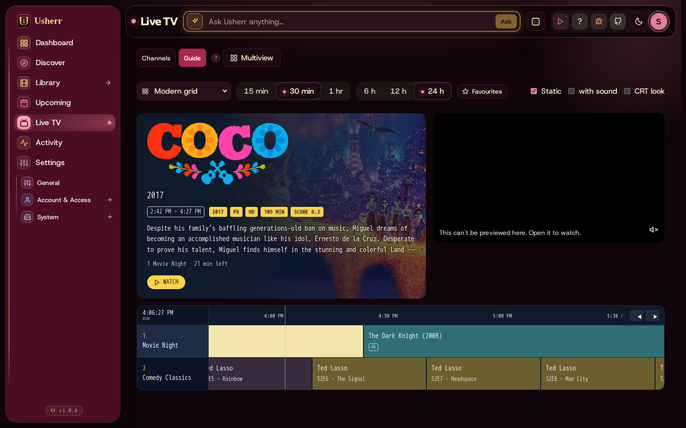

## Play on TV

**Optional.** Sends a stream to an Android TV box (such as an NVIDIA Shield),
which plays it in VLC or opens it in Stremio. Mediarium uses the box's network
debugging to do it.

- **On the TV box:** turn on *Developer options* (press *Build* seven times in
  *Settings → About*), then *Network debugging* (*USB debugging* on some boxes).
  A fixed address for the box in your router helps.
- **Put it in:** **Settings → Extras → Play on TV**: the box's address and a
  name, then **Pair** and allow the prompt that appears on the TV.
- **Check:** **Play on TV** on a title page starts it on the box.

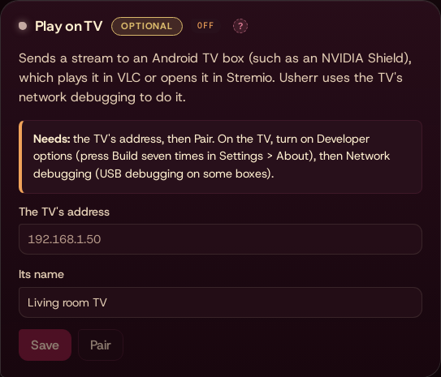

## Stremio and Nuvio

**Optional.** One add-on that works in both [Stremio](https://www.stremio.com)
and Nuvio: Usherr's own catalogs and streams inside the apps, on a phone,
a TV or a computer.

- **What it gives them:**
  - **Catalogs:** *Usherr Movies* and *Usherr TV* (your library and your streamed
    titles; the apps' search finds them too), *Usherr Watchlist* (the titles you
    gave a thumbs up) and *Usherr Live TV* (your channels).
  - **Streams** for any film or episode the app shows, even one that isn't in
    Usherr: first your library's own file, then the best releases Usherr's
    streaming engine finds on your indexers (up to six, with picture size, file
    size and indexer). A release opens when you pick it, and if it can't be read
    the next one is tried.
  - **Subtitles** from your library's files: the text subtitles in the file or
    next to it.
  - **Live TV:** a channel plays through the same address the tuner feed uses.
- **Put it in:** **Settings → Extras → Stremio and Nuvio** (an administrator), or the **You** page (everyone: each person's own link is there). Check the address your
  devices use for Usherr (your home network address, such as
  `http://192.168.1.20:8264`, or your https address from outside), then copy the
  link or scan the QR code. In Stremio: *Add-ons → Add add-on*, paste the link.
  In Nuvio: add it under its add-ons or plugins with the same link. This is done
  once in each app; with an https address the **Install in Stremio** button does
  it in one tap.
- **It is private:** the link has your own key in it, so the apps need no
  sign-in, and each person has their own (watchlist and permissions are theirs).
  **Make a new link** stops the old one working, for example if it was shared by
  mistake.
- **Streams from Usenet** need a Usenet server and an indexer set up (the same
  ones downloads use). Without them the library, watchlist and Live TV still
  work.

## AI

**Optional.** The Ask bar (find a title from a description or a photo,
*Tonight*, *Pick for the Room*, *Catch me up*, *What's it like?*, the skip
guide, reading orders, playlists, why a download failed), news summaries,
the family filter's estimates, and Live TV's AI channel builder and Real TV.
The AI only suggests: every title is checked on TMDB, and nothing is added
without you.

- **Choose one:** **Ollama** on your own computer (free and private), **Claude**
  (knows films best; paid by use, and `claude-haiku-5-5` as the model keeps it
  to pennies), or an **OpenAI-compatible server** such as LM Studio.
- **Put it in:** **Settings → Extras → AI**. *Answers a day for each person*
  keeps use in check (administrators aren't limited).
- **Check:** **Test it**, then ask something in the bar at the top of Discover.

See [The AI](ai.md) for every feature, the models and what they cost.

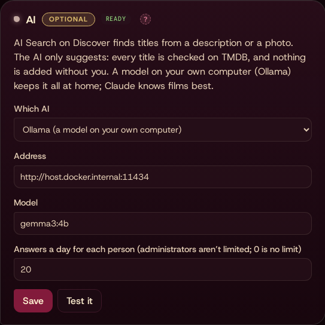

## Scores (MDBList)

**Optional.** IMDb, Rotten Tomatoes, Metacritic and Letterboxd scores and Common
Sense Media ages on Discover and title pages, and as filters in Discover
recipes. The family filter uses the Common Sense ages first.

- **Get it:** a free API key from mdblist.com (*Preferences → API*).
- **Put it in:** **Settings → Extras → Scores (MDBList)**.
- **Check:** **Test it**. Your library's titles are filled in first, a little
  each hour; Discover's are fetched as you browse.

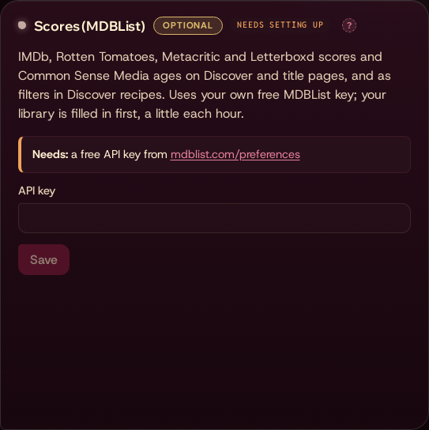

## Entertainment news

**Optional, needs the AI.** Short news under *Tonight* on the Dashboard: film
and TV, home theater, books, comics and music. Every few hours Mediarium reads
the feeds and the AI writes a short summary of each story, linking titles it
names to your library.

- **Set it up:** it comes with a list of feeds; untick any you don't want, or
  **Add a feed** (any RSS address). *Stories summarised a day* limits AI use.
- **Check:** **Read the feeds now**, then look at the Dashboard.

## In theaters

**Optional.** Films in cinemas near you: the *In theaters now* rows on the
Dashboard and at the top of Library → Movies, cinema openings on the
calendar, and links to showtimes on a film's page.

- **Set it up:** tick *Show films in theaters*, give your ZIP or postcode, your
  theater and the country (two letters, such as US).
- **Showtimes** under each film opens a search with every theater near you
  showing it, and **Tickets** opens it on your ticket service. **Tickets
  from** chooses Fandango (the default in the US), Atom Tickets, Cinemark,
  Moviefone, Showtimes.com, a link of your own (such as an AMC, Regal or
  local theater's search page, with `{title}` where the film's name goes and
  `{zip}` for your ZIP code), or none. With Fandango, **All showtimes near**
  (your ZIP) lists everything playing nearby.
- **Upload a picture** puts any picture you like on the chosen service's
  button, such as its logo; each service keeps its own, and Mediarium
  doesn't come with any.
- **Optional:** an AMC key (from developers.amctheatres.com) makes the row
  follow what your AMC theater is showing, with its showtimes.

## Marquee

**Optional.** A lobby display for a tablet or a screen by the TV, with its own
page (**Marquee** in the menu). See [The Marquee](marquee.md) for setting up a
screen, the looks, the pre-show, Home Assistant and the API.

## Pre-show

**Optional, nothing needed.** A cinema's pre-show before a film: a welcome,
trailers for what's coming, your own clips, the rating and the countdown. It's
ready as it is ("Movie night"); set it up on **Settings → Movie night →
Pre-show**.

- **Your clips:** put videos in the pre-show folder (`preshow` in Usherr's
  config folder), one folder per category, or upload them there.
- **Coming-soon trailers:** on by default; Usherr downloads them with yt-dlp
  (in its image). Map a folder with room to `/data/trailers`.
- **In the Jellyfin app:** **Set it up** installs the NeXroll Intros plugin
  in Jellyfin, then **Restart Jellyfin** loads it.
- **Check:** **Watch a sample**, then play a film in the Jellyfin app.
  See [The pre-show](preshow.md).

## Re-Posterr

**Optional.** Re-Posterr, Usherr's artwork picker, picks the poster, background and logo for each title in
Jellyfin from TMDB (and fanart.tv), and asks before changing anything.

- **Needs:** Jellyfin connected and the TMDB key.
- **fanart.tv (optional):** a free personal key from your fanart.tv profile,
  pasted on **Settings → Re-Posterr**.
- **Your style (optional):** posters, season posters, episode title cards and
  backgrounds made by Re-Posterr, the title in your font and layout on art
  without words; your own overlays, a style per library.
- **TheTVDB (optional):** a TheTVDB API key, for more art for shows.
- **Posterizarr (optional):** its address; it can take over the posters.
- **Check:** **Look now**, then see **Waiting for you**; or the **Re-Posterr** button
  on a film's page. See [Re-Posterr](re-posterr.md).

## Comics

**Optional.** Follow comic series, get new issues and read them in a
page-flip reader, with story arcs and a weekly pull list.

- **Get it:** a free ComicVine API key from comicvine.gamespot.com/api.
- **Put it in:** **Turn Comics on** in **Settings → Extras**, then the key under
  *Settings* on the **Comics** page. Comics are searched in your indexers'
  comics category.
- **Direct downloads (optional):** the *GetComics* card adds GetComics as a
  source. If GetComics shows a Cloudflare check, run FlareSolverr and enter its
  address (usually `http://host.docker.internal:8191`).
- **Check:** search for a series on the Comics page and add it.

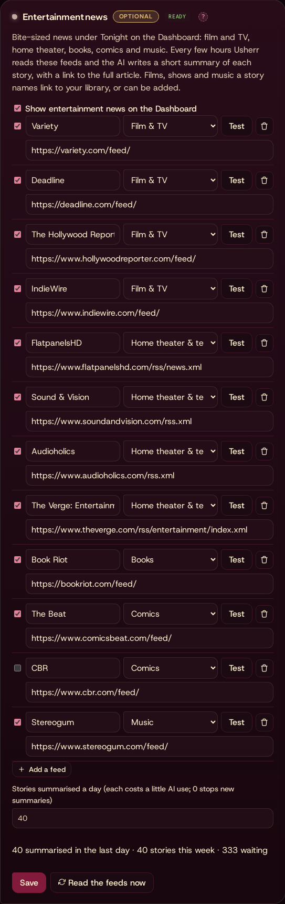

## Sports

**Optional.** A **Sports** page for everyone: leagues, the teams you follow and
the games of the coming two weeks. Games **stream** like films and episodes,
and can be **downloaded** when Sports runs on Sportarr. Choose what it runs on
in the *Sports* card in **Settings → Extras**:

- **Sportarr (stacked):** run Sportarr (github.com/Sportarr/Sportarr) next to
  Usherr, like Radarr or Sonarr, with your indexers (add it to Prowlarr as a
  *Sonarr* app), your download client, a root folder for sports and a quality
  profile. Enter its address (from Usherr's container, usually
  `http://host.docker.internal:1867`) and its API key (Sportarr's
  *Settings → General*). Streams use the releases Sportarr matches to a game;
  **Get** downloads through Sportarr.
- **Usherr's own engine:** no other app. Leagues and games come from
  TheSportsDB. Without a key Usherr uses TheSportsDB's free test key (search
  and part of each season, slowly); a paid key (thesportsdb.com/pricing, in
  your profile there once you subscribe) gives full schedules and scores. Games
  stream from your own indexers; downloading games needs Sportarr for now.
- **Streaming** needs Usherr's streaming engine (see *Streaming engine* above).
- **Check:** **Test Sportarr** or **Test TheSportsDB**, then open **Sports** in
  the menu and find a league. See [Sports](sports.md).

## Read-to-Me

**Optional.** Turns an ebook (an EPUB) into an audiobook with a computer voice on
your own graphics card: **Kokoro** for everyday narration, **Chatterbox** (started
only when wanted) for more expressive voices and copied voices. Each ebook's page
gets a **Read to me** button; the finished audiobook is filed with your audiobooks.

- **Get them:** run Kokoro (and, if you want it, Chatterbox) as containers on a
  computer with an NVIDIA card. The compose file and the steps are in
  [Read-to-Me](read-to-me.md#setting-it-up).
- **Put them in:** **Settings → Extras → Read-to-Me**: Kokoro's address (from
  Usherr's container, `http://host.docker.internal:8881`) and, optionally,
  Chatterbox's (`http://host.docker.internal:4123`). **Night only** keeps the work
  to the hours you choose.
- **Check:** **Test Kokoro**, then open an ebook and press **Read to me**; the
  first words of the book play in the voice you pick. See [Read-to-Me](read-to-me.md).

## NSFW 18+

**Optional, off unless you turn it on.** Adult videos, with performers and
studios. Only administrators ever see it: it is hidden from everyone else,
keeps its own library and its own download queue, and never sends
notifications. The server must allow it (`USHERR_ALLOW_ADULT`).

## Schedules

**Settings → Schedules** keeps heavy work to the hours you choose. Make named
schedules (one time range every day, or days and times), then give each task
one: automatic searches, downloads, repair and unpacking, and media server
refreshes. Anything you start by hand always runs at once. **Quiet for…**
holds every heavy task for a while, such as when TV time starts early;
everything picks up again by itself.

## Notifications

**Optional.** Messages when something is added, downloaded or fails, by email,
ntfy, Discord, Telegram and others, under **Settings → Connections →
Notifications**. Each person can also choose their own under
**Settings → Your profile**.

## Reaching Mediarium away from home

Mediarium is meant to sit behind your home network. To use it from your phone
away from home, use a private network such as Tailscale (nothing opened to the
internet), or a reverse proxy with HTTPS. Turn on two-step sign-in or passkeys
under **Settings → Account & Access → Security** before opening it up.
