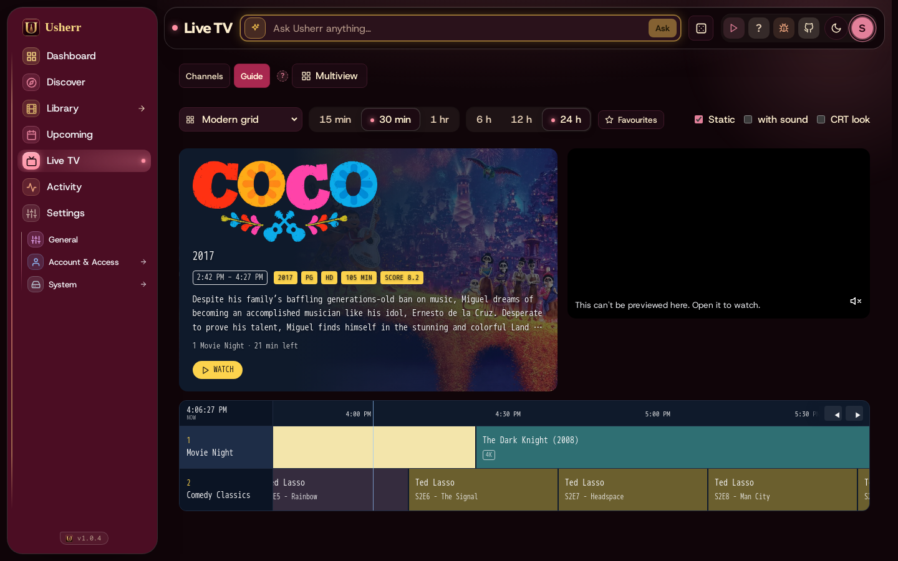
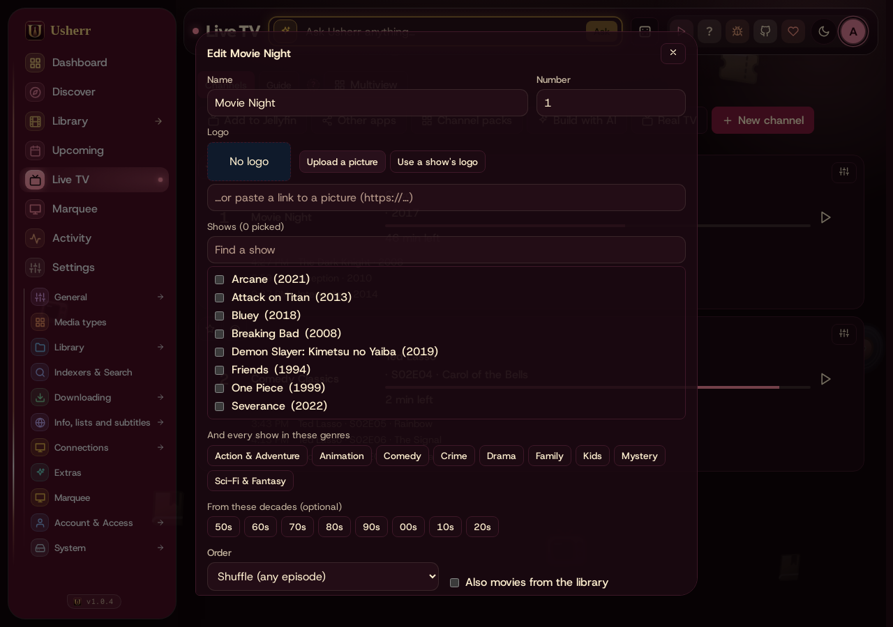
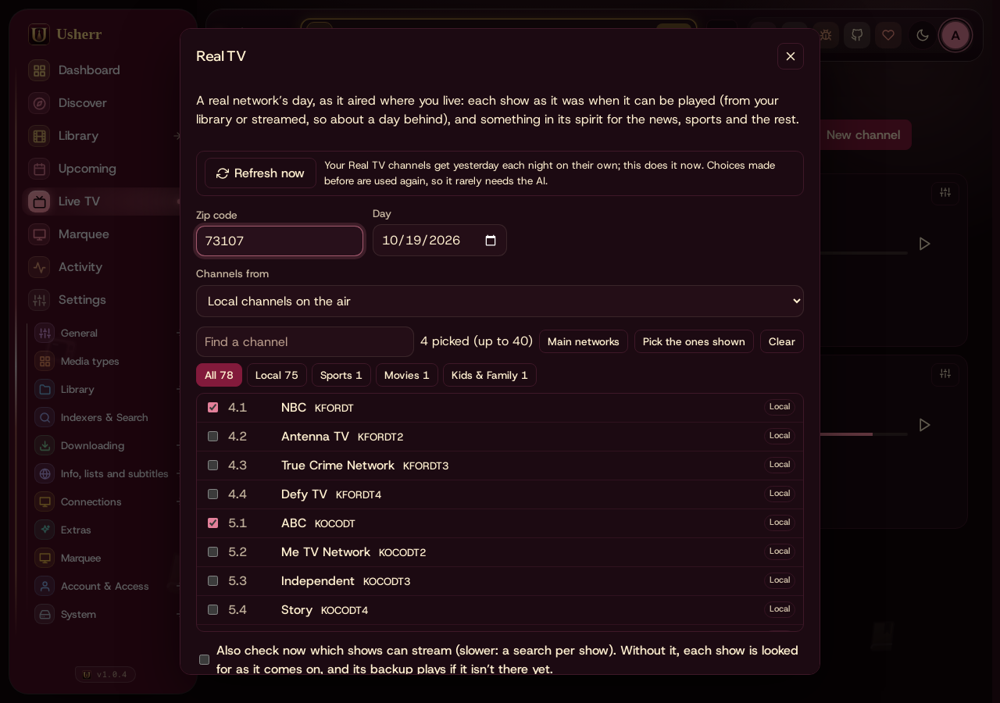

# Live TV

Live TV is channels, like broadcast TV: each plays on a schedule, and tuning
in plays whatever is on, from the right second. A channel can be made from
your library (a sitcom channel, a film night, Saturday-morning cartoons),
from shows streamed from Usenet that you don't have, from a free live stream
(Pluto, PBS), or from a real network's day as it aired (**Real TV**). Watch
them on the **Live TV** page, in Jellyfin, in Plex, or in an IPTV app such as
TiviMate.

Administrators make and change the channels; everyone can watch them.

## Watching

In Broadcast, **Live TV** in the menu opens on a guide made for the remote:
channels down the side (number, name and a star for favourites), two hours
across, and a glowing line at now. Up and Down land on what's on at the same
time on the next channel, Left and Right go along a channel, and the hours
move along when you reach the edge. The card under the guide shows the
programme you're on: OK watches what's on now, or opens a later one so you can
set a reminder. The Options key (or the **Options** button) has **Remind me**,
**Record**, **Start over** and the channel's star. While you watch, OK shows or
hides the overlay (the channel, what's on, a progress line and Up Next), Up and
Down change channel, the remote's Channel keys and digits work, and Back goes
back to the guide. The other guide styles below are still in the style list.
See [Broadcast and the remote](broadcast.md).

- **The guide**: channels down the side, time across. Tap a program to see
  what it is (its picture, the episode, when it first aired, its rating and
  whether it's HD or 4K); tap it again to watch. A later program offers
  **Remind me**.
- **Now on** shows every channel's current program as tiles.
- **Watching** is like a cable box: **Channel up** and **Channel down**
  (the ↑ and ↓ keys, the buttons, or a swipe), type a number to go to a
  channel, **Backspace** for the channel before, **I** for *What's on*. The
  banner says what's on, how long is left and what's next.
- **Start over** plays the current program from its beginning.
- **Multiview** plays four channels at once: tap a picture for its sound,
  double-tap to watch it full size.
- **Favourites**: star channels, then show *Only your favourite channels*.
  **Hide from the guide** takes a channel out of your own guide.
- **Reminders**: *Remind me* on a program sends a message to your phone five
  minutes before it starts. It needs a notification that takes reminders,
  such as ntfy (**Server › People › Notifications** in Broadcast,
  Settings › Notifications in Classic or Neu).
- **Guide style**, for each person: *Modern grid*, *Rounded tiles*, *'90s
  cable box*, *Prevue Guide* (the scrolling channel), *Newspaper listings*
  and *Now on (tiles)*. Under **Picture**: the *CRT look* (scan lines and a
  rounded glow) and *Static*, a burst of snow when you change channel.

A streamed program can take a moment the first time it's tuned after a
restart (Usherr finds and checks the release); the channel says *tuning
in…* and plays as soon as it's ready. Programs coming up on a channel
someone is watching are fetched a couple of minutes early so they start on
time.

## Making a channel

On the Live TV page, **New channel** (or **Channel packs**, or **Build with
AI**, below). A channel has a **name**, a **number** and a **logo** (upload
a picture, paste a link, or pick one of its shows' logos).

**What plays**

- **Shows**: pick shows from your library. **Find a show** also finds shows
  you don't have: they're streamed from Usenet (by Usherr's own engine, or
  StreamNZB), episode by episode, as they come on (they're marked
  *STREAMED*).
- **And every show in these genres** and **From these decades**: the channel
  fills itself from whatever the library has that fits, now and later.
- **Movies too**: films from the library (or *Also movies in those genres and
  decades*), and how many a day.
- **Order**: *In order* (one show start to finish), *Take turns* (the next
  episode of each show in turn) or *Shuffle* (any episode).

**Start times**

- **Back to back**: each show starts as the last one ends.
- **On the hour**, or every 15 or 30 minutes: shows start on a grid, like a
  real network, and the time between is filled (see *Between shows*).

**Parts of the day**: give *Morning*, *Mid-morning*, *Afternoon*, *Evening*,
*Prime time*, *Late night* and *Overnight* (on weeknights, weekends, or
both) line-ups of their own: cartoons in the morning, dramas in prime time.

**Shows at set times**: pin a show or a film to a day and time, such as a
*Sunday Night Movie* at 8 PM (*Add a set time*).

**Special programming**

- *Premieres*: new episodes first in prime time, marked *NEW*, reruns later.
- *Family hours*: nothing for older than about 10 before 9 PM.

**Between shows**

- A **folder of bumpers, idents and ads** (MP4 or WebM, optional), such as
  `/data/tv-filler`: they play in the gaps first.
- **"Up next" cards** fill what is left: what's coming on next.
- **Commercial breaks in each show**: 1, 2 or 3 breaks inside each program,
  played from that folder.

**Picture**: *By each show's age* makes shows from before 2000 look like old
TV (scan lines, softer colour, static between channels) and newer ones play
clean; or *Always old TV*, or *Always clean HD*.

**How far ahead** the schedule is made, and **Show this channel** (in the
guide and in Jellyfin) to take one off the air without deleting it.

In Broadcast the editor is made for a remote: the name is the only typing,
the number has − and +, shows, order and start times are buttons to press, and
**Save**, **Watch it now** and **Fill it with AI** are at the bottom. Genres,
films, streamed shows, parts of the day, the logo and the rest are under
**Advanced**.

### Channel packs

Ready-made channels that fill themselves from your library: *Sitcom Gold*,
*Saturday Morning*, *Movie Channel*, *Creature Feature*, *Crime & Mystery*,
*Discovery Hour*, *Sci-Fi Channel*, *Holiday Channel* (family shows that turn
festive in each season), *Rewind '70s–'90s* and more. A pack opens in the channel editor to look over before it's saved.

### Build with AI

Describe the channel (*A 1995 TGIF channel*, *Horror for October nights*,
*A cosy British mystery channel*) and choose *My library only*, *Library +
streamed* or *Mostly streamed*. The AI picks the shows and films, names shows
to stream that you don't have, and sets the start times, set times and
special programming. It opens in the channel editor; nothing is saved until
you save it. Needs the AI (see [The AI](ai.md)).

### A live stream

**Kind of channel › Live stream** carries a free stream such as Pluto or PBS:
its **stream address** (`.m3u8`), and optionally a **guide feed** (XMLTV,
such as `i.mjh.nz`'s) and the channel's id in it. Usherr relays the
stream, so it plays in the browser and in Jellyfin like the other channels.
Without a guide, the channel shows as *Live* in the guide.

## Real TV

**Real TV** rebuilds a real network's day as channels: the shows a station
aired on a day, each at its time, played as it aired when it can be. It runs
about a day behind (yesterday's shows are the ones that can be found to
stream), and each day repeats until the next refresh.

1. On the Live TV page, open **Real TV**. Enter your **zip code**; the day is
   yesterday to start.
2. **Channels from**: the *local channels on the air* (the network
   affiliates and their subchannels, such as MeTV and Cozi), or one of the
   cable and satellite providers at that zip code (ESPN, HGTV, TNT and the
   rest).
3. Pick the channels: search the list, or narrow it with **Kinds of
   channel** (*Local*, *Entertainment*, *News*, *Sports*, *Movies*, *Kids &
   Family*). The *Main networks* are ticked to start; up to 40.
4. Optionally a **Commercials folder**: ads that fill each slot's spare
   minutes, with "Up next" cards.
5. Optionally **Also check now which shows can stream**: slower (a search per
   show). Without it, each show is looked for as it comes on, and its backup
   plays if it isn't there yet.
6. **Build the day**, then **Make {n} channels**. Channels are made a few at
   a time, each with its number from the lineup.

How a day is filled:

- Each show is matched to its exact episode, **from your library** when it's
  there, else **streamed**.
- What can't be replayed (the 6 PM local news, a live game) gets **something
  in its spirit**, chosen by the AI: the same network's shows first, your
  library before streams.
- Each streamed show also gets a **backup** in its spirit, which plays if the
  show isn't on Usenet yet when it comes on (a different episode each day).
- The AI's choices are **remembered**: a slot is the same every weekday, so
  it's asked once and reused, and later builds and refreshes usually cost
  nothing.
- Real TV channels **refresh themselves each night** (between 4 and 6 AM)
  with the day before; **Refresh now** does it at once. A channel
  made before nightly refreshing existed won't refresh: delete it and make it
  again.

## In Jellyfin, Plex and other apps

Live TV's channels and guide can appear in other apps. The addresses are on
the Live TV page under **Other apps** (each holds a secret key, so
keep them to yourself):

- **Jellyfin**: **Add to Jellyfin** (on the Live TV page, or the Live TV
  card: **Server › Watching › Live TV** in Broadcast, Settings › Extras in
  Classic or Neu) adds Usherr as a tuner with its guide.
  Channels then show in Jellyfin's Live TV on every TV, after its next guide
  refresh.
- **Plex** (Plex Pass): **Add to Plex** on the Live TV page, beside Add to
  Jellyfin. Usherr answers as an HDHomeRun tuner, makes a DVR of it in Plex
  with its own guide, and switches the channels on. Pressed again, it has
  Plex read the guide again. Channels relayed from a live stream stay out of
  Plex's lineup. By hand instead: copy the **Tuner for Plex** address, then in
  Plex *Settings › Live TV & DVR › Set up Plex DVR*, *Don't see your HDHomeRun
  device? Enter its network address manually*, and paste it; when Plex asks
  for a guide, give it the **Guide (XMLTV)** address.
- **IPTV apps** (TiviMate and others): the **Channel list (M3U)** as the
  playlist, and the **Guide (XMLTV)** as the EPG source.
- **Stremio and Nuvio**: the add-on (the You page; or **Server › Watching › Apps on phones and
  TVs** in Broadcast, Settings › Extras › Stremio and Nuvio in Classic or Neu)
  includes the channels.

## The picture: encoder and watermark

**Server › Watching › Live TV** in Broadcast (in Classic or Neu: **Settings →
Extras → Live TV picture**). How channels make their picture
when it has to be converted: for a web browser that can't play a file, and
when the watermark is on. Without a watermark, channels send the picture as it
is.

- **Encoder**: **Automatic** (the default), **CPU (libx264)**, **NVIDIA
  (NVENC)**, **Intel Quick Sync** or **VAAPI**. Automatic tries each with a
  one-second test and uses the first that works, in that order. The card shows
  which work and, for the others, why not, with **Test again**. If an encoder
  fails while a channel plays, the CPU takes over for that program.
- **Show a watermark on channels** (off by default): each channel's logo, a
  picture you upload (PNG, JPG or WebP, up to 2 MB), or the channel number or
  name, in the corner you pick, with its size, opacity and distance from the
  edge. **Preview on** shows it on what a channel plays now, and each channel
  can be left without it. Changes apply from the next program.

To encode on an NVIDIA card, give the container the GPU in compose
(`gpus: all`, or a device reservation). Intel Quick Sync and VAAPI need
`/dev/dri` passed in as a device.

## When something is off

- **A channel says "off air"**: a streamed show had nothing to stream when
  it came on, and it had no backup. It plays again with the next program.
- **Jellyfin doesn't show the channels**: run Jellyfin's guide refresh
  (Dashboard › Scheduled tasks › *Refresh Guide*), and check that Jellyfin
  can reach Usherr's address (**Server › Smarts and connections ›
  Addresses** in Broadcast; Settings › Extras › *Usherr's address on your
  network* in Classic or Neu).
- **Plex's guide says *Unknown Airing***: a Plex page opened while the guide
  was still being read keeps the early empty rows. Reload the page (F5), or
  close and open Live TV again. If every channel still says it after a few
  minutes, Plex may have got stuck while switching the channels on: restart
  Plex (or the PC). Plex reads the guide again when it starts, which can
  take a few minutes with many channels. Then reload the page. Pressing
  **Add to Plex** again after that only has Plex read the guide again.
- **Channels stop after a restart**: if the server got a new address on your
  network, the tuner and guide addresses Plex and Jellyfin were given no
  longer answer. Reserve the server's address in your router (see
  [Usherr's address on your network](integrations.md#usherrs-address-on-your-network)),
  then press Add to Plex or Add to Jellyfin again.
- **"Its schedule is still being made"**: a new or changed channel takes a
  moment; the guide fills in by itself.
- **A Real TV channel still shows an older day**: the listings may not have
  had the day yet; the nightly refresh tries again, or use **Refresh now**.
