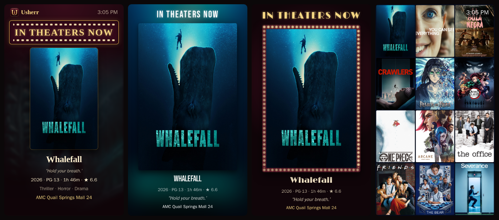
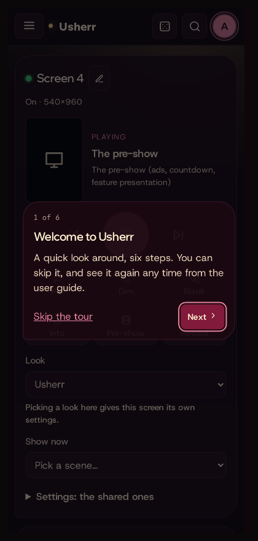
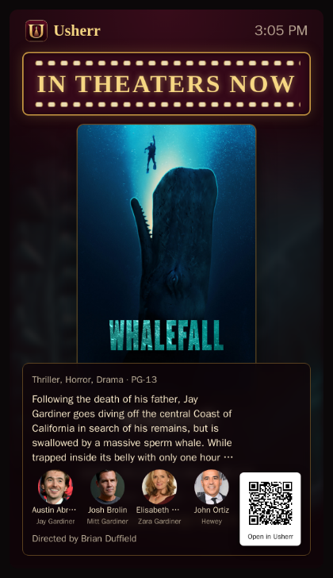
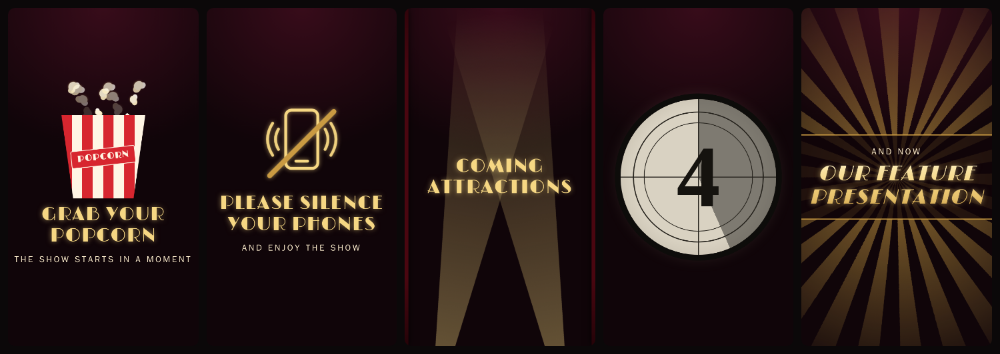

# The Marquee

The Marquee is a lobby display for a tablet or a screen next to the TV, like
the board outside a cinema: what's playing right now, new and coming films
with their trailers, what's in theaters, tonight on Live TV, your own slides
and a pre-show before the film. It comes in seven looks, each with its own
themes, fonts, frames and effects, and every screen can be steered from your
phone or from Home Assistant.

Everything about it is on its own page: **Marquee** in the menu (or in
Settings), for administrators.



## Setting up a screen

Any browser that shows `http://<Mediarium's address>:8264/marquee` full-screen
is a Marquee screen. Sign in once on it; it stays signed in.

- **A tablet:** a kiosk browser (such as Fully Kiosk Browser) with the address
  above as its start page. Switch on *Autoplay videos* and *Autoplay audio*
  for trailers, your videos and theme music.
- **A monitor or TV on a PC:** Chrome in kiosk mode on that screen, for
  example `chrome.exe --kiosk --window-position=1920,0
  --user-data-dir=C:\MarqueeChrome
  --autoplay-policy=no-user-gesture-required http://localhost:8264/marquee`.
  Turn the screen to portrait in Windows' display settings.
- **A name:** add `?screen=tablet` (or any name) to the address to give the
  screen a fixed name; without it, the screen keeps an id of its own.

The screen shows up under **Marquee › Screens** by itself.

## The Marquee's page

| Tab | What's there |
|---|---|
| Screens | Every screen, on or off, what it shows now, and its remote. Rename a screen, move it up or down the list (the arrows), give it settings of its own, or forget it. Screens are numbered in the order they first opened the Marquee; a new one goes at the end. |
| Look and scenes | The shared settings, for every screen. A screen can keep a few of its own (a look picked for it on the remote, or anything changed under its own settings); the rest still follows these, and this tab lists what each screen keeps, with a button to drop it. |
| Slides and pre-show | Your own pictures, videos, web pages and words. |
| Home Assistant and API | The connection to Home Assistant, and how scripts steer the screens. |

The **phone remote** is the Screens tab on its own, made for a phone:
`/marquee/remote`. Add it to your phone's home screen.



On the remote: **previous**, **pause/play** and **next**; **Pin** (play this
scene again and again), **Dim**, **Blank**, **Info** (the plot and cast over
the film), **Pre-show** (start it now), **Reload**; **Look** (this screen's
look) and **Show now** (jump to a scene).

## Looks

| Look | In the spirit of | What it is |
|---|---|---|
| Usherr | | A lit marquee sign over one scene at a time; long lists scroll. |
| Cinema | Posterrama | One poster as big as it goes, a header and a footer, a glow of its colours. |
| One-sheet | now-showing-ha | A framed poster (chasing bulbs, a gold line or neon) under a marquee header. |
| Posterr | posterr | A coloured banner, the poster and the title; progress while playing. |
| Poster wall | Posterrama | A wall of posters that turn one at a time, or one film big above the wall. |
| Screensaver | Posterrama | The picture across the whole screen, with the title and a clock. |
| Showtimes board | ScreenStage | Rows like a cinema's board: now, tonight on Live TV, in theaters, coming. |

Each look takes a **theme** (eight, or your own accent and background), a
**font** for its signs and titles, **corners**, a **frame**, poster
**framing** (fill, letterbox, on a mat), a **transition** between slides
(crossfade, slide, zoom, flip and more, or a different one each time),
**effects** (a slow pan and zoom, film grain, vintage colour) and **screen
care**: everything moves a few pixels now and then against burn-in, and it can
dim at night.

## What it shows

The scenes, in the order you set, each for as long as you set; a scene with
nothing to show is skipped.

- **Now showing**: what's playing, wherever it plays: Jellyfin or Emby,
  StreamNZB (Nuvio, Stremio), and Usherr itself: its player in the browser
  (library files, Stream now, Live TV, labelled with the channel) and its
  Stremio and Nuvio add-on. Each shows with its progress and badges (below).
  It shows up within half a minute of starting and leaves when the player
  closes. *Now showing comes from* on the Look and scenes tab turns each
  source off.
- **New on the server**, **In theaters now**, **Coming soon**: one film at a
  time, and as poster lists; **Trailer**: the film's trailer.

**Badges** (*Badges* on the Look and scenes tab) say what's playing really
is:

- the cinema format: how it was shown (**IMAX**, **IMAX 70mm**, **Dolby
  Cinema**, **70mm**) and shot (**65mm film**, **35mm film**, **Digital**),
  and **Black & white**. These come from IMDb's technical specifications,
  asked once per film in the background; TMDB's release notes fill in when
  IMDb has nothing (they name a format for some films only), and an IMAX
  edition says so in its release name. IMDb allows its data for personal,
  non-commercial use; *Cinema formats from IMDb* turns it off;
- the picture: **4K**, **Dolby Vision** or **HDR10**, and its shape
  (**2.39:1**, **1.85:1**, **16:9**...). A widescreen film stored with black
  bars is measured inside the bars;
- the sound: **Dolby Atmos**, **DTS:X**, **TrueHD**, **DTS-HD MA**, **Dolby
  Digital+**..., and its channels (**7.1**, **5.1**, **Stereo**).

Jellyfin and Emby say what they play. For a library file Usherr plays, the
badges come from the details Mediarium reads from every file's headers in
the background (the same ones a film's page shows); only when the picture
could hold black bars does Usherr look at a few seconds of it for its real
shape. A stream is looked at once, a few seconds after it starts; until then
its badges come from its release name.
A film that isn't playing shows its cinema formats only.

**Trailers fill** (Look and scenes tab) zooms trailers on a portrait screen:
*As they are* (letterboxed), *A poster's size* (a 2:3 window, like the
posters; the sides are cut off) or *All the space there is*. It applies to
the Cinema, Posterr and One-sheet looks and to the pre-show's trailers (your
own pre-show videos fill too).
- **Coming up**: the week ahead; **On Live TV**: what each channel has on.
- **Tonight on Usherr TV**: each channel's next hours, with the times.
- **In the spotlight**: a director or star with their films, marked when the
  film is on your server.
- **Did you know?**: facts about the films from TMDB (no AI).
- **Your slides** and **the pre-show** (below).

On a film, an **info panel** (the plot, the cast with their photos, the
director) can show always, when paused, or only from the remote; a **QR
code** in the corner can open the trailer or the film in Mediarium on a phone.
*While something plays, show only that* keeps what's playing on screen.



## Your slides and the pre-show

Under **Slides and pre-show**:

- **Your slides** take turns in the *Your slides* scene: upload a picture or a
  video (PNG, JPG, WebP, GIF, MP4 or WebM, up to 2 GB), or add a web page or
  your own words (*Movie night, Friday at 8*).
- **Your pre-show** plays in the pre-show.

The **pre-show** is like the cinema's: *Grab your popcorn*, *Please silence
your phones*, your own pieces, *Coming attractions* and up to three trailers,
a film-leader countdown, and *Our feature presentation*. The built-in pieces
are drawn on the screen, so they are sharp on any screen and take its theme
and font; switch any of them off in **Look and scenes**. It plays as a scene
in the order, from the remote's **Pre-show** button, or, when *Play it when
something starts playing* is on, as soon as something starts.



## Theme music

With *Theme music* on, a film's or show's theme plays, faded in and out,
while it is on screen: a `theme.mp3` in its folder, or the first song in a
`theme-music` folder there. Jellyfin's *Theme Songs* plugin puts them in
exactly those places. The screen's browser must allow sound (see *Setting up
a screen*).

## Home Assistant

Under **Home Assistant and API**, tick *Connect to Home Assistant* and give
your MQTT broker's address, user name and password. Home Assistant's own
*Mosquitto broker* add-on works (use a Home Assistant user, or one made for
the add-on); **Test the connection** says at once whether it got in.

Each screen then appears in Home Assistant by itself (Settings › Devices ›
*Marquee …*), with:

- buttons: Next, Previous, Start the pre-show, Reload;
- switches: Pause, Pin, Dim, Blank, Info panel;
- choices: Look, and Show now (a scene);
- Showing (what's on it, with its scene), On (whether it is on), and the
  Poster as a picture.

For example, dim the Marquee when the room lights go off:

```yaml
automation:
  - alias: Marquee dims with the lights
    trigger:
      - platform: state
        entity_id: light.living_room
        to: "off"
    action:
      - service: switch.turn_on
        target:
          entity_id: switch.marquee_tablet_dim
```

## Scripts and buttons (the API)

Anything that can call a web address can steer the screens: a Stream Deck,
iOS Shortcuts, Tasker, a script. Make an API key in **Settings › Security**
(as an administrator) and send it as `X-Api-Key`. A screen is named by its
name (`tablet`), its id, or `all`.

```
curl -X POST http://<address>:8264/api/home/marquee/screens/tablet/command \
  -H "X-Api-Key: YOUR_KEY" -H "Content-Type: application/json" \
  -d '{"cmd":"next"}'
```

| Call | What it does |
|---|---|
| `POST /api/home/marquee/screens/<screen>/command` | A button: `{"cmd":"next"}`; `prev`, `preshow`, `reload`; `{"cmd":"scene","arg":"trailer"}`; `pause`, `pin`, `dim`, `blank` or `info` with `"arg":"on"` or `"off"`. |
| `POST /api/home/marquee/screens/<screen>/look` | Another look: `{"style":"cinema"}` (`usherr`, `cinema`, `onesheet`, `posterr`, `wall`, `screensaver`, `board`). |
| `GET /api/home/marquee/screens` | Every screen: on or off, its size, its settings and what it shows. |
| `GET /api/home/marquee/screens/<screen>/poster` | The poster on that screen now. |

## When something is off

- **The screen shows the sign-in page**: sign in once on that screen.
- **No sound**: the screen's browser blocks it until allowed (*Autoplay
  audio* on a tablet; `--autoplay-policy=no-user-gesture-required` for
  Chrome).
- **A web page slide stays blank**: some sites refuse to be shown inside
  another page; that can't be changed from Mediarium.
- **The screen stopped answering after a while**: the computer running
  Mediarium may have a new address on the network; give it a fixed one in
  the router (*DHCP reservation*).
- **Home Assistant shows nothing**: check *Test the connection*, and that
  MQTT discovery is on in Home Assistant (it is by default).
