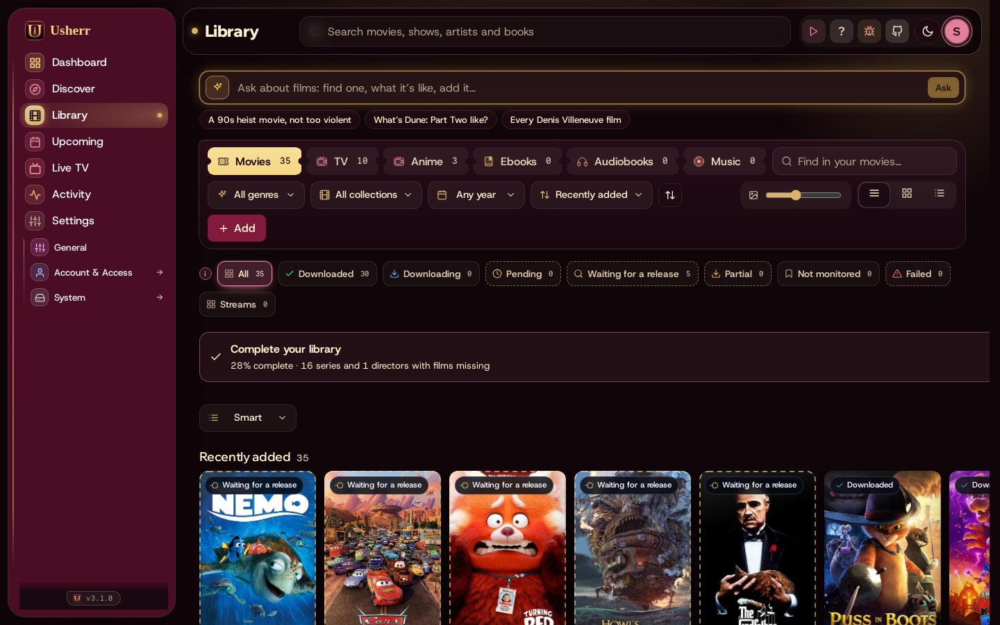
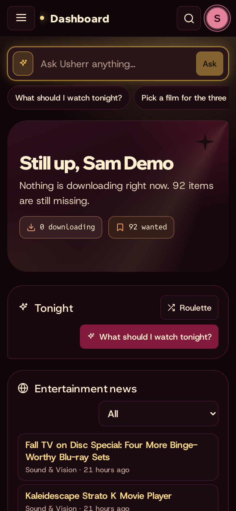

# Watching it

## Play, or Stream

- **Play** plays a title that's in the library, right in the browser or on the
  phone.
- **Stream** plays one that isn't downloaded, straight from the internet,
  without waiting. It opens a small sheet: pick the quality (remembered on this
  device) and where to play, and it starts in a few seconds. If a stream
  stalls, **Try another release** in the player. **Keep it** downloads it for
  later.
- In the Library, titles marked **Streams** aren't on disk: they always play
  this way.
- **What the browser can't play is converted, and nothing else.** A 4K film
  stays 4K, HDR stays HDR and 5.1 stays 5.1. Most often only the sound is
  converted: Dolby (E-AC3, Atmos), TrueHD and DTS, which Chrome and Edge play
  silently, become AAC with the same channels, while the picture plays as it
  is. A stream that starts silent gets its sound this way within a few
  seconds, and seeks as usual. The delay your speakers add (spatial sound,
  a receiver, Bluetooth) is allowed for; if it's still a little off, the
  player's **− Sync +** buttons move the sound earlier or later, 50 ms a tap
  (tap the number to put it back). It's kept on each device.
  Only a picture the browser can't show at all
  (an old XviD, or HDR on a screen without it) is converted, at its own
  size. A smaller picture only comes from a quality you pick.
- **Up next**: near the end of an episode (its last 15 seconds, or when it
  ends) a card offers the next one and plays it after a 10-second countdown:
  your file when you have it, otherwise a stream at this device's quality.
  **Not now** closes it; *Play the next episode by itself* (kept on each
  device) turns the countdown off, leaving the button. Only episodes that
  have aired are offered; Live TV keeps to its own schedule.
- **Skip intro**: while an intro plays, a button jumps past it. Usherr knows
  where intros (and credits) are from the file's own chapters when they're
  named so (Intro, Opening, OP, Credits, Ending, ED), or from Jellyfin, when
  its *Intro Skipper* plugin has found them. When the credits are known,
  *Up next* comes up as they start. Without either, there's no button.
- **Pick up where you left off**: movies, episodes, NSFW videos, streams and
  sports games open where you stopped, and comics at the page, on any device
  (it's kept on the server for each person). The player says
  *Picked up at …*, with **Start over**. Past 95% (or in the last 45
  seconds) or under 15 seconds in, it starts at the beginning. Live TV is
  live and never picked up. Music starts each song from the top; the
  ebook reader, the audiobook player and the comic reader have their own
  **Start over**.
- **Audio & subtitles** in the player picks the language, for files and
  streams alike (a stream offers its sound tracks; its subtitles aren't read,
  since that means reading the whole film). The language you pick is
  remembered, and a release with several (MULTi) starts in it.

## Releases that play

Usherr's own streaming engine learns which releases play. Each release it
opens counts for its release group and its indexer; one that won't open,
breaks part-way, or is passed over with **Try another release** counts
against them. A group or indexer that has failed at least three times and
mostly fails goes to the back of the list, so the next stream starts with
releases that work. Everything else keeps its order, nothing extra is asked
of your indexers, and a release you pick yourself is always the one tried.

## Showtimes at home

Book a film for a time, like a cinema: **Showtime** on a film's page (or on
its poster in your stack) asks when, how many minutes of pre-show the Marquee
runs first, and where the film plays.

- **Starts:** a date and time, or **right after** another booking, for a
  double feature (ten minutes after the first film ends).
- **Pre-show on the Marquee first:** at showtime minus these minutes, the
  pre-show starts on every Marquee screen that's on, by itself.
- **The film plays:**
  - **On the Showtime screen:** open the **Showtime** page (`/showtime`) in
    the browser on the TV and leave it there. It counts down and starts the
    film at showtime: your file, or a stream. Press **Ready** once when you
    open it, so the browser lets it start with sound. Usherr's own
    [pre-show](preshow.md) plays there first, full screen, so the feature
    starts on the minute.
  - **On the TV:** the film opens there (Play on TV) at showtime.
  - **I'll start it myself:** for watching in Jellyfin, Stremio or Nuvio.
    The Marquee still counts down and runs the pre-show.

Until then, the Marquee shows a band over whatever it's showing, for example
"Showtime 8:00 PM · Dune: Part Two · in 12 min". The **Showtime** page
lists every booking, to move 15 minutes either way or cancel (your own, or
any for an administrator); the Marquee's page links to it.

## On the TV

- **Jellyfin** (or Emby) on the TV has everything in the library, streamed
  titles included; they play like anything else.
- **Play on** *(the TV's name)*, for example *Play on Living room TV*, in the
  player sends what you're watching to the TV box, which plays it in VLC (or
  opens it in Stremio). It's there once the TV has been paired.
- **Copy home link** gives a link VLC or another player on the home network can
  open.

## The Library

Everything the house has, in tabs: **Movies**, **TV**, **Anime**, **Ebooks**,
**Audiobooks**, **Music**, **Comics**.

- **Shelves** shows rows that scroll sideways: *Recently added*, *On the way*,
  by genre, by decade and more. The menu above them chooses how the rows are cut
  (*Smart*, by genre, by mood…). The grid button shows one big grid instead.
- The chips filter by state: **Downloaded**, **Downloading**, **Waiting for a
  release**, **Streams** and the rest.
- **Find in your movies** searches what's here.

## Live TV

Channels like broadcast TV, made from the library, from streams, from free
live channels, or rebuilt from a real network's day (**Real TV**).

- **Guide** shows what's on now and next; tap a program twice to watch, or
  once later on for **Remind me**. **Watch** joins a channel where it is.
- Change channel like a cable box (↑ ↓, a number, Backspace for the last
  one), or watch four at once in **Multiview**.
- The same channels show in Jellyfin, Plex and IPTV apps such as TiviMate.

See [Live TV](live-tv.md) for everything: making channels, packs, the AI
builder, scheduling like a network, Real TV and the other apps.

## Upcoming

- **Calendar**: new episodes and films coming out, of what's in the library.
- **Wanted**: what's been added but isn't here yet.
- **Following**: the people you follow (see
  [People and following](finding.md#people-and-following)).

## Comics

The **Comics** tab in the Library: your series, with new issues each week.
Open an issue to read it page by page (swipe or use the arrow keys);
**Panels** mode zooms panel by panel on a phone, and the **page-turn** view curls
the pages like paper (two side by side on a wide screen). *Catch me up* recaps a series
up to where you stopped, and **Story arcs** lists what to read in which order.

## On a phone

Mediarium works the same on a phone. To keep it like an app, open it in the
phone's browser and choose **Add to Home Screen** (Safari's share menu on an
iPhone, or the ⋮ menu in Chrome on Android).

